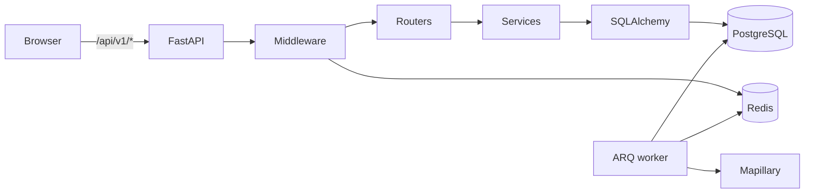
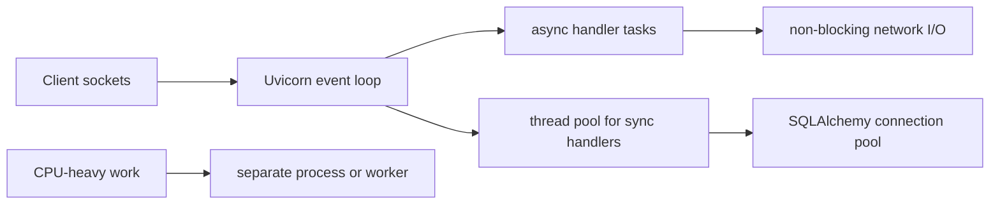
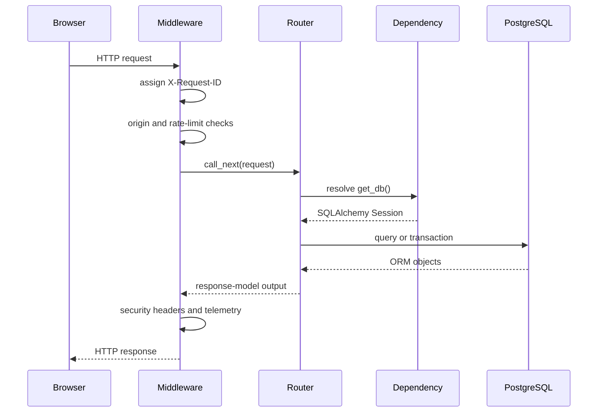
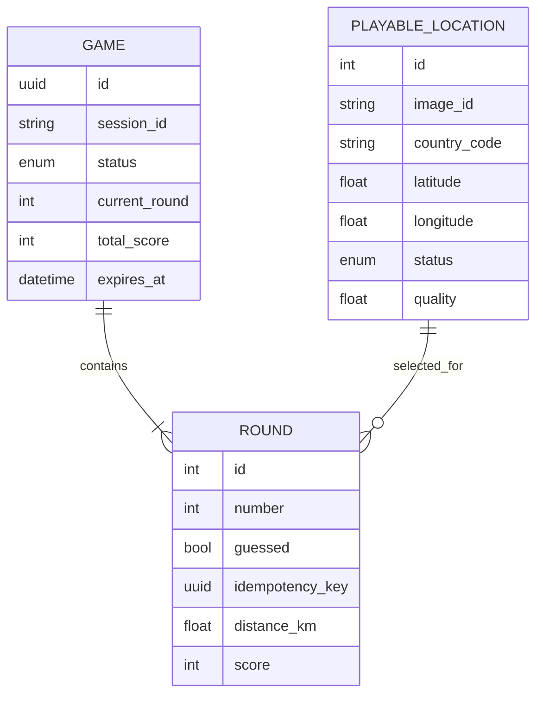
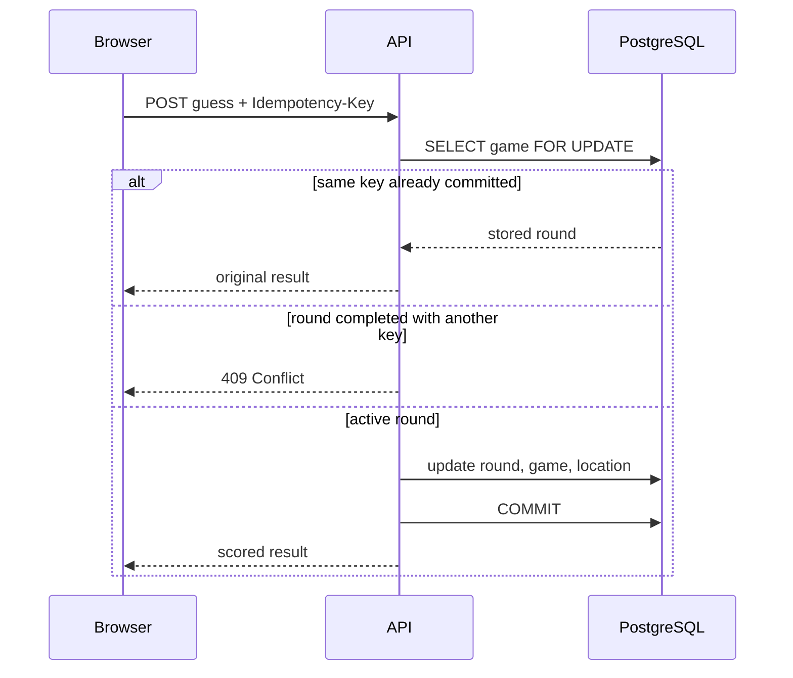

# 01 · Backend with FastAPI

[← Course overview](../README.md) · [Next: Frontend with React →](../02-frontend/README.md)

WorldGuessr's backend is a **modular monolith**: one FastAPI application owns the HTTP API and
game rules, while a separate process from the same Python package runs background jobs. This
chapter uses the real request paths to review FastAPI, Pydantic, SQLAlchemy, PostgreSQL, Redis,
and asynchronous provider work.


*Visual anchor: follow the solid request path to the transactional database; treat cache and
worker paths as accelerators or deferred work, never as hidden owners of game truth.*

### What an interviewer is testing

| Area | A strong explanation connects |
|---|---|
| API design | resource model, HTTP semantics, validation, versioning, errors, and contract evolution |
| Persistence | session scope, transaction boundary, isolation, indexes, constraints, and query shape |
| Correctness | invariant, race condition, lock or atomic operation, idempotent retry, and test evidence |
| Resilience | timeout, retry classification, jitter, circuit breaking, backpressure, and degradation policy |
| Security | identity, authentication, authorization, browser threat, secret boundary, and abuse control |
| Operations | liveness, readiness, structured logs, low-cardinality metrics, tracing, and SLO impact |

## The backend at a glance



The modules have deliberately narrow responsibilities:

| Module | Responsibility |
|---|---|
| `app/main.py` | Application construction, lifespan, middleware, and router registration |
| `app/routers/` | HTTP endpoints and translation between HTTP errors and domain behavior |
| `app/schemas.py` | Pydantic request and response contracts |
| `app/services.py` | Game creation, location selection, scoring, and expiry rules |
| `app/models.py` | SQLAlchemy mappings and database relationships |
| `app/db.py` | Engine, session factory, and the database dependency |
| `app/security.py` | Signed guest sessions and same-origin mutation checks |
| `app/rate_limit.py` | Redis-backed request limiting |
| `app/catalog.py` | Mapillary discovery and catalog maintenance |
| `app/worker.py` | ARQ job registration and schedules |

This separation is not the same as microservices. The modules share one data model and are
released together. Keeping the domain in one deployable unit makes transactions and local
reasoning straightforward while the application is small.

## Application construction and lifespan

`create_app()` constructs the `FastAPI` object, supplies OpenAPI metadata, installs middleware,
and includes the game and operations routers. Keeping construction in a function makes it
possible to create isolated applications in tests instead of relying only on module import
side effects.

FastAPI's `lifespan` argument accepts an async context manager. Code before `yield` runs during
startup and code after it runs during shutdown. WorldGuessr currently uses startup to configure
logging; the same boundary is where shared async clients or other process-wide resources would
normally be created and closed.

```python
@asynccontextmanager
async def lifespan(_: FastAPI):
    logging.basicConfig(level=logging.INFO, format="%(message)s")
    yield


application = FastAPI(
    title="WorldGuessr API",
    version="1.1.0",
    lifespan=lifespan,
)
```

The exported `app = create_app()` is the ASGI object loaded by Uvicorn. ASGI lets the server
pass requests, responses, and lifecycle events to the framework without tying the application
to a specific web server.

## Python, ASGI, and the concurrency model

Concurrency means making progress on multiple operations; parallelism means executing work at
the same instant. The distinction matters when choosing between async tasks, threads, and
processes.



An `async def` coroutine runs on the event-loop thread until it awaits an operation that yields
control. This is efficient for many concurrent sockets only when the libraries below it are
also asynchronous. Calling a blocking SQL driver, filesystem operation, or CPU-heavy function
inside that coroutine blocks other tasks on the same loop.

FastAPI/Starlette runs normal `def` route handlers and dependencies in a thread pool. That fits
WorldGuessr's synchronous SQLAlchemy and Psycopg stack. Threads let blocking requests overlap,
but each active database operation still needs a connection and consumes downstream capacity.
The pool is therefore part of the concurrency limit, not an implementation footnote.

In standard CPython, the Global Interpreter Lock means only one thread executes Python bytecode
at a time within a process. Threads still help I/O-bound work because the running thread waits
or native code releases the lock. CPU-heavy scoring at real scale would use optimized native
code, a process pool, or a separate worker; adding async syntax would not make it parallel.

Multiple server processes can use multiple CPU cores and isolate crashes, but each process owns
its own memory, counters, and database pool. Four processes with a 10-connection pool can expose
roughly 40 database connections before overflow behavior. Capacity planning must multiply the
whole topology across processes and pods.

The selection rule is practical:

| Work | First choice | Main risk |
|---|---|---|
| Many non-blocking network waits | async tasks | one hidden blocking call stalls the loop |
| Blocking library with bounded calls | thread pool | too many threads/connections create contention |
| CPU-heavy pure Python | process/worker or native code | serialization cost and operational complexity |
| Durable deferred provider work | queue + idempotent worker | backlog, duplicates, poison jobs |

## One request through FastAPI

Every request first passes through the `request_controls` middleware in `app/main.py`.



Middleware is appropriate for behavior that applies broadly: request IDs, security headers,
rate limiting, and timing. Endpoint-specific rules stay in routers and services.

For mutating methods, the middleware calls `enforce_same_origin()`. If an `Origin` header is
present, its scheme and authority must match `PUBLIC_ORIGIN`. Requests without an `Origin`
header are allowed, which supports non-browser clients; an edge proxy must therefore remain
part of the security design.

The middleware uses `request.state` to make the request ID available during that request. It
also returns the ID in `X-Request-ID`, allowing a client-visible failure to be correlated with
structured server logs.

## Routing, dependencies, and validation

`APIRouter(prefix="/api/v1")` groups the game API under a versioned path. The application
exposes these domain endpoints:

| Method and path | Purpose |
|---|---|
| `GET /api/v1/config` | Return safe browser configuration |
| `POST /api/v1/games` | Select five locations and create a game |
| `GET /api/v1/games/{game_id}` | Resume the current round |
| `POST /api/v1/games/{game_id}/rounds/{number}/guess` | Score one round |
| `GET /api/v1/games/{game_id}/summary` | Return a completed game's rounds |

FastAPI inspects function annotations to decide where each value comes from. A UUID parameter
in the path is parsed before the handler runs. `GuessIn` is parsed from JSON. The
`Idempotency-Key` annotation reads and validates a required UUID header. `Depends(get_db)`
opens a SQLAlchemy session for the request and closes it when the generator dependency exits.

```python
def guess(
    game_id: uuid.UUID,
    number: int,
    body: GuessIn,
    idempotency_key: uuid.UUID = Header(alias="Idempotency-Key"),
    db: Session = Depends(get_db),
):
    ...
```

Invalid types or out-of-range coordinates produce a validation response before domain code
runs. The constraints live beside the schema:

```python
class GuessIn(BaseModel):
    latitude: float = Field(ge=-90, le=90)
    longitude: float = Field(ge=-180, le=180)
```

Response models are equally important. They filter and serialize returned values into a stable
public shape. In particular, the current round reveals the imagery identifier but not the
answer coordinates. The coordinates appear only in `GuessResult`, after the guess is stored.

The OpenAPI document generated from these routes and models is exported to
`backend/openapi.json`. The frontend contract command converts it into
`frontend/src/generated/api.d.ts`. This makes the backend schema the contract source of truth,
even though the small handwritten frontend types currently mirror the same shapes.

## Configuration with Pydantic Settings

`Settings` in `app/config.py` maps environment variables into typed Python fields. Pydantic
Settings handles parsing values such as integers and booleans, can read a local `.env` file,
and ignores unrelated variables.

`get_settings()` is cached with `lru_cache`, so one process normally constructs the settings
object once. This is efficient, but tests that change environment variables must clear the
cache before expecting new values.

Configuration is divided by trust:

- Database URLs, the signing secret, and the server-side Mapillary Graph token remain server
  secrets.
- `/api/v1/config` deliberately exposes only the public Mapillary client token, map style URL,
  attribution, and round count.
- A browser token must still be restricted by provider and origin rules. “Public” means safe
  to deliver to the client, not unrestricted.

## Guest identity and ownership

There are no accounts. `session_id()` obtains the `wg_session` cookie, verifies its signature
with `itsdangerous`, or generates a random identifier and sets a new cookie.

The cookie is:

- `HttpOnly`, so frontend JavaScript cannot read it;
- `SameSite=Lax`, reducing cross-site sending;
- `Secure` in the production environment;
- signed, so the client can hold it but cannot silently change the identifier.

Signing provides integrity, not encryption. The generated identifier is opaque and contains no
personal data. Each game stores that session identifier, and `owned_game()` deliberately
returns `404` both for a missing game and a game belonging to another guest. That avoids
revealing whether another session's UUID exists.

The frontend's saved game UUID and the cookie solve different problems. `localStorage` tells
the browser which game to request after a refresh; the signed cookie proves that the current
guest owns it.

## SQLAlchemy sessions and the data model

`create_engine()` owns the connection pool. `pool_pre_ping=True` checks a borrowed connection
before using it, reducing errors from stale connections. `SessionLocal` constructs short-lived
units of work with `expire_on_commit=False`, allowing already-loaded values to be serialized
after a commit without an automatic refresh.



A `Game` owns five ordered `Round` rows. Deleting the game cascades to its rounds. A round
references a reusable `PlayableLocation`; deleting a game therefore does not delete catalog
data. The unique `(game_id, number)` constraint prevents duplicate round numbers, and the
unique idempotency key prevents one operation identifier from being attached to multiple
rounds.

`selectinload()` loads rounds and their locations in follow-up `IN` queries. This avoids both a
query per round and the row multiplication that a large joined eager load can create.

Alembic owns schema evolution. Migration `0001` enables PostGIS and creates an expression GiST
index over a geography point built from longitude and latitude. The current scoring path uses
Python's Haversine function rather than a PostGIS distance query, but the index prepares the
catalog for spatial filtering or proximity searches. Migration `0002` adds persisted
idempotency keys.

## Domain services: choosing and scoring locations

The service layer contains rules that do not need to know about HTTP.

Creating a game first asks which countries have enough active locations. When a real Mapillary
Graph token is configured, demo image IDs are excluded. The selection algorithm:

1. Loads the guest's recently used location IDs.
2. Shuffles eligible countries.
3. Cycles through countries to spread five rounds geographically.
4. Avoids recent and already-chosen locations where the catalog permits.
5. Uses location quality as a random weight.
6. Creates the game and all five rounds in one commit.

The guess distance is calculated with the Haversine formula, which treats Earth as a sphere and
uses latitude/longitude radians to estimate great-circle distance. The score decays
exponentially:

```text
score = round(5000 × e^(-distance_km / 2000))
```

It is clamped between `0` and `5000`, producing a maximum game score of `25,000`.

`assert_playable()` changes an expired game's status before raising. The router commits that
transition and maps it to HTTP `410 Gone`. A completed but unexpired game remains readable so
the summary can be restored.

## Concurrency and idempotent guesses

A guess changes the round, the game total, the current round number, and the location's
selection timestamp. These changes must behave as one transaction.



`SELECT ... FOR UPDATE` serializes concurrent submissions for the same game. Without it, two
requests could both observe `guessed=False`, both add a score, and overwrite each other.

The idempotency key handles a different problem: uncertainty. If the database commits but the
response is lost, the browser retries with the same key and receives the saved result. A
different key after the round has completed receives `409`, because it represents a competing
operation rather than a retry.

Idempotency therefore needs all three pieces:

- a stable client-generated operation key;
- durable storage of the key and result-driving data;
- transaction-level concurrency control.

## Redis rate limiting

The middleware identifies clients by `request.client.host` and uses a fixed time bucket. A Lua
script atomically increments the key, applies expiry to a new bucket, and returns its TTL.
Atomic execution prevents races between `INCR` and `EXPIRE`.

When the count exceeds the configured limit, the API returns `429` with `Retry-After`. Redis
operations use short connection and command timeouts to avoid making every API request wait on
a struggling cache.

The default is fail-open: a Redis error allows gameplay to continue. This matches the data
ownership rule that Redis contains only reconstructible operational state. It also means the
deployment needs an edge-level abuse control; otherwise a Redis outage removes the application
limit. A security-sensitive mutation might reasonably choose fail-closed instead.

The implementation is intentionally simple. IP identity behind trusted proxies, IPv6
aggregation, distributed edge limits, and rolling-window accuracy are deployment concerns not
solved by the current bucket.

## Background catalog work

The ARQ worker shares the backend image and Python package but runs
`app.worker.WorkerSettings` instead of Uvicorn. Redis coordinates jobs; PostgreSQL stores the
durable catalog.

The worker refills the Mapillary catalog at startup and four times daily, deletes expired games
daily, and prunes old inactive locations weekly. With a Graph token, catalog discovery queries
small bounding boxes around ten configured cities. Requests have a timeout and bounded
exponential retry with jitter. A particular dense-region `500` response is retried as four
smaller cells.

Returned imagery is validated, deduplicated, and upserted. Once enough real countries meet the
minimum pool size, demo locations are marked stale. If the real catalog is still too small and
demo mode is allowed, demos remain active.

`CountryCatalog.provider_cursor` and the `ProviderState` model exist in the schema, but the
current worker does not use cursors or implement a persisted circuit breaker. They should be
understood as extension points, not as active resilience features.

## Health and observability

Liveness and readiness answer different questions:

- `/health/live` says the process can serve HTTP.
- `/health/ready` checks PostgreSQL and Redis, reports individual latency, and returns `503`
  when either dependency is down.

Kubernetes can restart a failed liveness probe and remove a failed readiness probe from
service. Keeping these meanings separate avoids restart loops during a dependency outage.

The middleware writes JSON request logs and updates in-process counters. `/metrics` renders a
small Prometheus-compatible text format for request totals and summed durations. Dynamic game
UUID paths are normalized to control metric cardinality.

These metrics reset whenever a process restarts and are not aggregated across replicas. A
production deployment would normally use a metrics library and external scraper or telemetry
collector, but the current implementation clearly demonstrates the measurement boundary.

## Testing strategy in the repository

Backend tests concentrate on deterministic domain and security behavior: distance and score
calculation, location selection, expiry, signed sessions, and origin enforcement. External
provider calls and Redis failure modes should be isolated behind mocks when extended; tests
should not rely on live Mapillary access.

The most valuable additional integration cases would exercise concurrent guesses against
PostgreSQL, same-key retry after a committed response is lost, readiness degradation, and
catalog refill rollback. Those cases cross boundaries that unit tests alone cannot prove.

## Backend interview drill

Answer each prompt in 60–90 seconds before reading the framework. The strongest answers start
with the invariant or failure being protected and end with a trade-off or verification method.

| Prompt | Strong answer framework |
|---|---|
| Why use `def` handlers with a synchronous SQLAlchemy `Session` instead of marking everything `async`? | `async` improves concurrency only when the call stack uses non-blocking I/O. Blocking database work inside `async def` can stall the event loop; FastAPI can run normal `def` handlers in a thread pool. Choose one coherent I/O model, size its database pool, and load-test it. |
| What does dependency injection buy this API? | The handler declares capabilities such as a request-scoped session; the framework creates and cleans them up. This separates resource lifecycle from domain logic, composes authorization or configuration, and makes tests replace dependencies without a service locator. |
| Pydantic model versus SQLAlchemy model? | A Pydantic schema is an untrusted-input/public-output contract; an ORM model maps persistence identity and relationships. Keeping them separate prevents accidental field exposure and lets API and schema evolution move at different rates. Neither replaces database constraints. |
| Where should a transaction begin and end? | Around one business invariant, not one repository method and not an entire user interaction. For a guess, lock the game, validate the round, write round/game/location changes, and commit once. Keep remote provider calls outside because a database rollback cannot undo them. |
| Why are both a row lock and idempotency key necessary? | The row lock serializes concurrent writers that saw the same state. The durable operation key handles an ambiguous retry after commit and lets the server replay the prior outcome. A lock alone forgets the earlier request; a key without an atomic transaction can still race. |
| What does PostgreSQL `READ COMMITTED` mean here? | Each statement sees a fresh committed snapshot. `SELECT ... FOR UPDATE` waits for and then locks the current row version, so the service re-evaluates game state after the winning transaction. Broader isolation is possible but would add retries and contention; use the narrowest mechanism that proves the invariant. |
| Should Redis failure make the API fail open or fail closed? | Decide per threat and business impact. This game fails open for availability because Redis is non-authoritative, but that removes an abuse defense. Pair it with edge limits and an alert. Sensitive operations may fail closed; document and test the degraded mode. |
| How should background jobs be retried? | Retry only transient failures, with timeouts, exponential backoff, jitter, and a cap. Make the job idempotent through a natural key/upsert, bound concurrency to protect the provider, expose queue age and last success, and dead-letter or inspect permanent failures. |
| Is a signed cookie encrypted or authenticated? | Signed means integrity: tampering is detectable. It does not hide the value. Use an opaque random identifier, `HttpOnly`, `Secure`, and `SameSite`; authorize the referenced resource server-side and add a complete CSRF strategy for cookie-authenticated mutations. |
| Liveness versus readiness? | Liveness answers “should this process be restarted?” Readiness answers “should it receive traffic?” A dependency outage normally affects readiness, not liveness, or orchestration can turn one database incident into a restart storm. |
| How would you diagnose a slow guess endpoint? | Start with one request ID and decompose edge, handler, pool wait, SQL, lock wait, and commit latency. Check latency percentiles rather than averages, query plans and index use, pool saturation, downstream timeouts, and changes in error/retry rate. Profile before scaling. |
| What tests prove retry safety? | Use real PostgreSQL and two concurrent clients. Cover same key/same payload, same key after a deliberately lost response, different keys racing, rollback before commit, and restart between attempts. Assert one score contribution and a stable returned result. |

### Whiteboard checkpoints

You are ready to move on when you can do these without the chapter:

1. Draw the request path and mark validation, authorization, transaction, and response-contract
   boundaries.
2. Write the three-step lost-response timeline that makes an idempotency key necessary.
3. Explain why a database unique constraint is still valuable when application validation exists.
4. Compare fixed window, sliding window, and token bucket rate limiting, including memory,
   burstiness, and atomicity.
5. Propose three RED signals for the API and three domain signals for catalog health.

## External reading: backend foundations

Read in this order; the first group explains the framework boundary, the second the correctness
boundary, and the third the production boundary.

**Framework and contracts**

- [FastAPI dependencies](https://fastapi.tiangolo.com/tutorial/dependencies/) — dependency
  graphs, reuse, and cleanup; map it to `get_db()`.
- [FastAPI concurrency and `async`/`await`](https://fastapi.tiangolo.com/async/) — how path
  functions, blocking libraries, threads, and coroutines interact.
- [FastAPI lifespan events](https://fastapi.tiangolo.com/advanced/events/) — process-wide
  startup and shutdown resources.
- [ASGI specification](https://asgi.readthedocs.io/en/latest/specs/main.html) — the server/app
  protocol for connection scopes, events, and application instances.
- [Python `asyncio`](https://docs.python.org/3/library/asyncio.html) — event loops, tasks,
  synchronization, and non-blocking I/O primitives.
- [Python threading and GIL considerations](https://docs.python.org/3/library/threading.html#gil-and-performance-considerations)
  — why threads help I/O but do not automatically parallelize Python bytecode.
- [Pydantic Settings management](https://pydantic.dev/docs/validation/latest/concepts/pydantic_settings/)
  — typed configuration sources and precedence.
- [OpenAPI Specification](https://spec.openapis.org/oas/) — the language-independent API
  contract behind generated frontend types.

**Data and concurrency**

- [SQLAlchemy Session basics](https://docs.sqlalchemy.org/en/20/orm/session_basics.html) — unit
  of work, transaction framing, identity map, and session scope.
- [PostgreSQL transaction isolation](https://www.postgresql.org/docs/current/transaction-iso.html)
  — anomalies and the exact behavior of `READ COMMITTED`.
- [PostgreSQL explicit locking](https://www.postgresql.org/docs/current/explicit-locking.html) —
  row-lock modes, waits, deadlocks, and consistent lock ordering.
- [PostgreSQL indexes](https://www.postgresql.org/docs/current/indexes.html) — index types,
  multicolumn design, partial indexes, and planner trade-offs.
- [Idempotent Receiver pattern](https://martinfowler.com/articles/patterns-of-distributed-systems/idempotent-receiver.html)
  — why a server stores request identity and a prior response.

**Security, limits, and operations**

- [OWASP CSRF Prevention Cheat Sheet](https://cheatsheetseries.owasp.org/cheatsheets/Cross-Site_Request_Forgery_Prevention_Cheat_Sheet.html)
  — origin checks, SameSite, and when tokens remain necessary.
- [OWASP Session Management Cheat Sheet](https://cheatsheetseries.owasp.org/cheatsheets/Session_Management_Cheat_Sheet.html)
  — cookie and session lifecycle controls.
- [Redis rate-limiter patterns](https://redis.io/docs/latest/develop/use-cases/rate-limiter/) —
  fixed/sliding windows, token buckets, and atomic Lua decisions.
- [ARQ documentation](https://arq-docs.helpmanual.io/) — async job execution, retries, and
  worker configuration.
- [OpenTelemetry observability primer](https://opentelemetry.io/docs/concepts/observability-primer/)
  — metrics, logs, traces, SLIs, and user-centered reliability.

## Backend mental model

Keep these ideas together when reading or extending the backend:

- FastAPI annotations define where validated request data comes from.
- Pydantic models form the public boundary; SQLAlchemy models form the persistence boundary.
- A request-scoped session is a unit of work, not a global database connection.
- Row locks protect concurrent state transitions; idempotency keys make uncertain retries safe.
- PostgreSQL owns game truth. Redis can be lost without losing scores.
- The worker is operationally separate but remains part of the same application and schema.
- Documentation should describe implemented behavior separately from production aspirations.

[Continue to Frontend with React →](../02-frontend/README.md)
