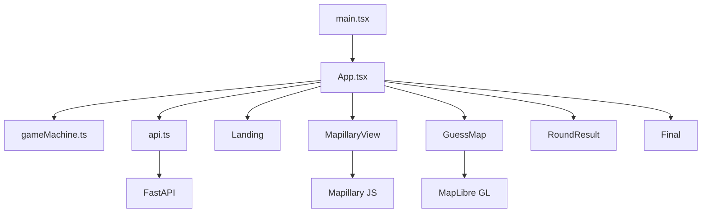
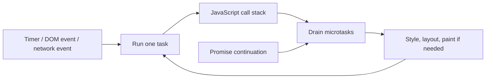
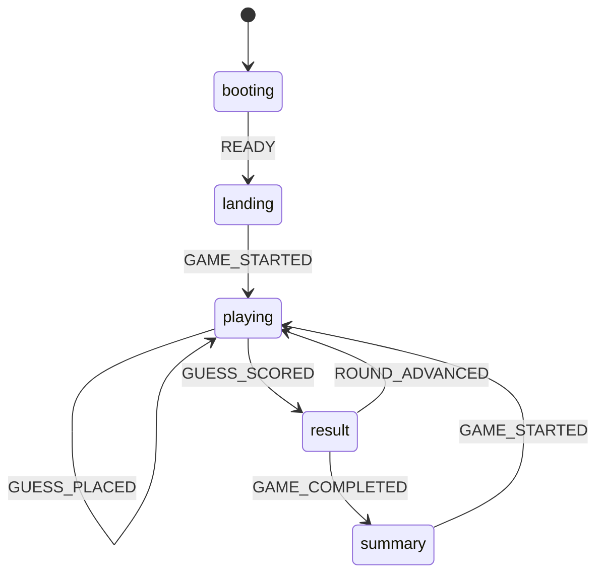
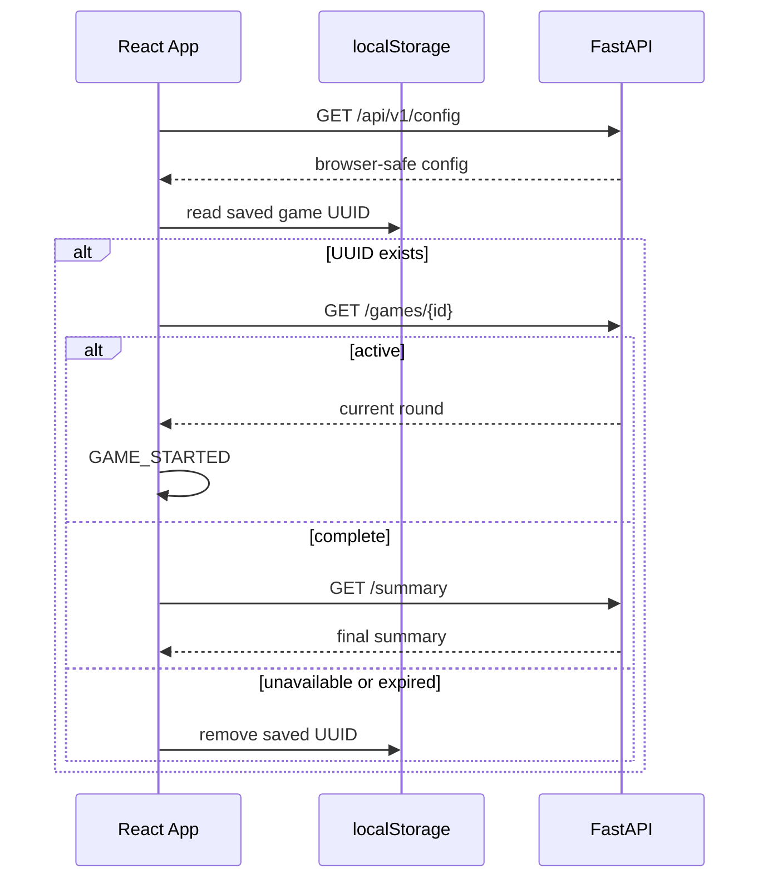

# 02 · Frontend with React

[← Backend with FastAPI](../01-backend/README.md) · [Course overview](../README.md) ·
[Next: Architecture and system design →](../03-system-design/README.md)

WorldGuessr's frontend is a small React 19 single-page application written in TypeScript and
built by Vite. Its size makes the important ideas unusually visible: server state versus UI
state, reducer-driven transitions, asynchronous effects, typed HTTP boundaries, lazy loading,
and integration with imperative mapping libraries.


*Visual anchor: events enter the state model, rendering leaves it, and effects synchronize only
the external systems React does not own.*

### What an interviewer is testing

| Area | A strong explanation connects |
|---|---|
| JavaScript/TypeScript | runtime semantics, event loop, closures, narrowing, generics, and the limits of static types |
| React | render purity, state ownership, reducer transitions, effects, cleanup, identity, and error boundaries |
| Data fetching | HTTP state, cancellation, stale responses, retry safety, caching, and user feedback |
| Performance | bundle cost, render cost, network waterfall, Core Web Vitals, measurement, and trade-offs |
| Accessibility | semantic HTML, keyboard and focus behavior, announcements, contrast, and automated/manual tests |
| Testing | confidence boundary, deterministic state tests, component behavior, integration adapters, and browser flows |

## The frontend at a glance



The key files form four layers:

| File | Role |
|---|---|
| `main.tsx` | Creates the React root and enables Strict Mode |
| `App.tsx` | Orchestrates loading, game actions, and phase-specific UI |
| `gameMachine.ts` | Defines state, actions, and legal state transformations |
| `api.ts` | Owns HTTP, errors, cookies, and guess idempotency keys |
| `types.ts` | Describes the application-facing API data |
| `MapillaryView.tsx` and `GuessMap.tsx` | Adapt imperative third-party viewers to React |

## Bootstrapping React

The entry point finds the root DOM element and renders `<App />` inside `<StrictMode>`.
`createRoot()` enables React's modern concurrent-capable root API.

Strict Mode adds development checks. In particular, React may run an effect setup and cleanup
an extra time to expose unsafe side effects. It does not mean production performs every request
twice. Components that create viewers, subscriptions, or timers must still clean them up
correctly so the development check is harmless.

Vite handles the development server, TypeScript-aware module graph, React transform, and
production bundling. Its development proxy sends `/api` and `/health` to the backend container,
letting browser code use same-origin relative URLs in both local and deployed environments.

## Browser and JavaScript execution fundamentals

JavaScript on the main thread runs one call stack at a time. The browser surrounds it with Web
APIs, queues, rendering, networking, storage, and worker processes. “Single threaded” does not
mean the browser can perform only one activity; it means long synchronous JavaScript prevents
the main thread from handling input or rendering until that stack returns.



A click handler and an expired timer enqueue tasks. A resolved Promise schedules its reaction as
a microtask. After the current stack finishes, the runtime drains microtasks before moving to a
later task and normally before the next rendering opportunity. `await` pauses the coroutine; its
continuation also runs through Promise/microtask machinery. Recursive microtasks can therefore
starve timers and rendering even though each callback is “asynchronous.”

The browser dispatches DOM events along a capture phase toward the target and a bubble phase
back through ancestors. Event delegation attaches one stable ancestor listener and identifies
the descendant through the event target. React provides a normalized event layer, but native
propagation, default actions, focus behavior, and passive pointer/scroll listeners still matter
when integrating mapping libraries.

Browser security boundaries are related but different:

- The same-origin policy restricts one origin from reading another origin's resources.
- CORS is a response-header protocol by which a server permits selected cross-origin reads; it
  is not authentication and does not stop non-browser clients from sending requests.
- CSRF abuses credentials a browser sends automatically, such as cookies. Same-origin mutation
  checks, SameSite, and tokens are possible defenses.
- XSS runs attacker-controlled script in the trusted origin. Context-aware escaping, avoiding
  unsafe HTML, dependency hygiene, and a restrictive CSP reduce risk; CORS does not fix XSS.

## State as a reducer

`useReducer()` stores the game workflow in one `GameState`:

```typescript
type GameState = {
  phase: "booting" | "landing" | "playing" | "result" | "summary";
  config: Config | null;
  game: Game | null;
  guess: Coordinate | null;
  result: GuessResult | null;
  summary: Summary | null;
  error: string;
};
```

Events describe what happened rather than how to mutate individual fields:

- `READY` stores public configuration.
- `GAME_STARTED` enters play and clears the previous attempt.
- `GUESS_PLACED` stores a coordinate.
- `GUESS_SCORED` stores the server-authoritative result.
- `ROUND_ADVANCED` replaces the game view and clears round-local state.
- `GAME_COMPLETED` stores the final summary.
- `FAILED` preserves the current phase and adds an error.



A reducer is useful when several fields must change together. Starting a game is not merely
`game = created`; it must also clear the old guess, result, summary, and error. Centralizing
that transformation makes it deterministic and independently testable.

The reducer is state-machine-like rather than a fully enforced finite-state machine. It does
not reject an action received in the wrong phase, and `App` mostly chooses screens from the
presence of `config`, `game`, `result`, and `summary` rather than switching directly on
`phase`. The phase remains useful documentation, but those duplicated representations could
drift if future actions update one without the other.

## Rendering is derived from state

`App` returns early for the major screens:

1. No configuration: loading screen.
2. Summary exists: final screen.
3. No active round: landing screen.
4. Result exists: round result.
5. Otherwise: active game.

This is declarative UI. The code does not manually hide one page and reveal another. It updates
state, React runs the component again, and the current state determines the tree.

`mapOpen` and `busy` remain local `useState` values because they are transient UI concerns:
whether the map panel is expanded and whether an action is in flight. They do not belong to
the durable game model.

The child functions `Landing`, `RoundResult`, and `Final` receive the smallest data and
callbacks they need. They are kept in the same file because they are tightly coupled to this
single flow; extraction would become more valuable if they gained independent behavior or
reuse.

## Initial loading and saved-game recovery

The mount effect first loads `/api/v1/config`. After configuration arrives, the UI is ready and
the effect checks `localStorage` for `worldguessr.activeGame`.



The saved UUID is only a resume pointer. The browser automatically sends the `HttpOnly`
session cookie because API requests use same-origin URLs and `credentials: "same-origin"`.
The server still checks ownership.

When a real client token is present but the saved round refers to a `demo-` image, the
frontend discards the pointer. This avoids resuming placeholder imagery after a deployment has
moved to a real catalog.

The effect catches a failed resume and removes stale storage. A failure to load the initial
configuration is different: it dispatches `FAILED`, but because `config` remains null the
current loading branch does not display the error. That is a present limitation worth noticing
when reasoning about failure UI.

## Asynchronous user actions

The `start`, `submit`, and `advance` functions bridge user events to the API:

- `start()` creates a game, dispatches it, and saves its UUID.
- `submit()` sends the chosen coordinate and stores the scored result.
- `advance()` fetches the next round or the final summary.

`busy` disables actions while a request is running and is reset in `finally`, so both success
and failure release the UI. Errors are narrowed with `instanceof Error` before reading
`.message`, which is necessary because JavaScript permits throwing any value.

There are two important boundaries:

- The guess is local and tentative until the server accepts it.
- Score, distance, total, actual location, and game completion always come back from the
  server. The browser never calculates authoritative game results.

`advance()` currently does not wrap its awaits in the same error handling used by `start()` and
`submit()`. A network failure during next-round or summary loading can therefore become an
unhandled rejected promise. The handbook describes this as current behavior rather than
implying every asynchronous path is equally protected.

## The typed API boundary

`request<T>()` is a small generic wrapper around `fetch`:

```typescript
async function request<T>(url: string, init?: RequestInit): Promise<T> {
  const response = await fetch(url, {
    credentials: "same-origin",
    headers: { "Content-Type": "application/json", ...init?.headers },
    ...init,
  });
  if (!response.ok) {
    const body = await response.json().catch(() => ({ detail: "Something went wrong" }));
    throw new Error(body.detail ?? "Something went wrong");
  }
  return response.json();
}
```

It standardizes JSON headers, cookie behavior, non-2xx errors, and deserialization. The generic
type provides compile-time help to callers, but it does **not** validate JSON at runtime. If
the server returns an unexpected successful shape, TypeScript cannot detect it in the browser.
Runtime schema parsing would be needed for that guarantee.

The endpoint functions hide URL construction from components. `App` says `api.summary(id)`
rather than knowing the complete route. This makes the boundary easier to mock and change.

The backend's exported OpenAPI document can generate `src/generated/api.d.ts`. The repository
also contains concise handwritten types in `types.ts`; maintaining both means contract
generation can detect drift, but application code does not yet consume the generated
definitions directly.

## Retry-safe guess submission

A POST may commit even when the browser never receives its response. Retrying with a fresh
operation identity could look like a second guess. `api.ts` solves this with a module-level
`Map` keyed by `game_id:round`.

```typescript
const operation = `${id}:${round}`;
const key = pendingKeys.get(operation) ?? crypto.randomUUID();
pendingKeys.set(operation, key);
```

The key remains in the map when `request()` throws, so a retry during the same page lifetime
sends the same `Idempotency-Key`. It is deleted only after a successful response. A later
round has a different operation name and receives a new key.

This works with the backend's stored key and row lock to create end-to-end idempotency. The
pending keys are not persisted, so a full page reload after an ambiguous response loses the
key. Resume will reveal that the server advanced, but the exact failed operation cannot be
replayed from browser storage.

## Hooks and closure behavior

`useCallback()` memoizes the `choose` function:

```typescript
const choose = useCallback(
  (coordinate: Coordinate) => dispatch({ type: "GUESS_PLACED", coordinate }),
  [],
);
```

`dispatch` is stable, so the empty dependency list is valid. The stable callback also prevents
`GuessMap`'s map-creation effect from rerunning merely because `App` rendered again.

Effects capture values from the render that created them. Dependencies tell React when a new
effect must replace the previous one. Omitting a changing dependency risks a stale closure;
adding an unstable object or callback can recreate expensive external resources on every
render. The mapping adapters show why dependency design matters.

## Lazy loading and Suspense

Mapillary and MapLibre are large, browser-only libraries. `React.lazy()` changes their static
imports into separate dynamic chunks:

```typescript
const GuessMap = lazy(() =>
  import("./GuessMap").then((module) => ({ default: module.GuessMap })),
);
```

The landing screen can load without parsing the mapping libraries. When a lazy component is
first rendered, its nearest `Suspense` boundary shows a loading fallback until the module
arrives.

Lazy loading here optimizes JavaScript delivery, not API data fetching. The configuration and
game requests are still managed explicitly in effects and event handlers.

## Integrating imperative map libraries

React owns a declarative DOM tree, while Mapillary and MapLibre expect a real container and
mutate it imperatively. Both adapters use the same bridge:

1. Render an empty host `<div>`.
2. Store the element in `useRef`.
3. Create the external instance in `useEffect`.
4. Store mutable handles in refs when later effects need them.
5. Remove the instance during cleanup.

`MapillaryView` recreates its viewer when the token or image changes and calls
`viewer.remove()` during cleanup. Without cleanup, Strict Mode, navigation, and round changes
could leak WebGL contexts and event listeners.

If the token is missing or the image ID begins with `demo-`, the component renders an
explanatory placeholder instead of constructing the viewer.

## MapLibre data flow

`GuessMap` creates the world map once for a given style, interaction mode, and callback. A map
click converts MapLibre's longitude/latitude object into the application's
`{ latitude, longitude }` type and calls `onChange`.

GeoJSON and MapLibre use coordinate arrays in `[longitude, latitude]` order. The application
type uses named fields, which reduces mistakes at most call sites, but every conversion at the
library boundary must preserve the reversed array order.

Separate effects handle separate external mutations:

- A `value` change removes the previous guess marker and adds a new one.
- A `result` change adds the actual-location marker, creates a GeoJSON line between guess and
  answer, and fits the viewport to both.

The result waits for the map's `load` event before adding a source and layer. Those operations
require a loaded style. This is a common pattern when an imperative dependency has its own
lifecycle inside React's lifecycle.

The map instance is removed on cleanup. The separately created result marker is not held in a
ref, but removal of the whole map clears it when the component unmounts.

## Styling, accessibility, and responsive UI

The UI uses semantic `main`, `nav`, `section`, `header`, and button elements. Loading fallbacks
use `role="status"`, and the in-game error toast uses `role="alert"` with an assertive live
region. Native buttons retain keyboard activation and disabled behavior.

The map host has an accessible label, but a visual map remains intrinsically difficult for
screen-reader-only interaction. The current application does not provide a non-pointer
coordinate picker, focus management between phases, an Escape handler for the map panel, or
an error boundary around mapping libraries. These are improvement opportunities, not features
already implemented.

CSS gives each phase a distinct layout while the React state determines which layout exists.
The result map is non-interactive, reinforcing that its job is explanation rather than input.

For CSS debugging, reason in this order:

1. **Cascade:** origin/importance, cascade layer, selector specificity, scoping, then source
   order decide which declaration wins.
2. **Box:** content, padding, border, margin, intrinsic size, min/max constraints, and
   `box-sizing` determine the element's used size.
3. **Layout:** normal flow, flexbox, and grid solve different one- and two-dimensional
   relationships. Absolute positioning removes an item from normal flow.
4. **Paint/composite:** layout changes can force geometry recalculation and paint; transform and
   opacity animations are often compositable, but measurement should drive optimization.
5. **Responsive/accessibility:** prefer content-driven breakpoints, flexible sizing, logical
   properties, visible focus, reduced-motion support, and zoom-safe layouts.

Reading layout in that order is faster than escalating selector specificity or adding fixed
pixels until one viewport happens to look correct.

## Testing the state model

`gameMachine.test.ts` tests the reducer without a DOM. Given a known state and action, a reducer
should always return the same next state and should not mutate the old object. This makes it
the cheapest place to verify round-local resets and phase changes.

Broader frontend confidence would combine:

- reducer tests for state transitions;
- API tests for error parsing and stable idempotency keys;
- component tests with mocked HTTP responses;
- adapter tests with mocked Mapillary and MapLibre objects rather than real WebGL;
- a small browser smoke test for resume and the five-round flow.

These layers test application behavior without making routine tests depend on provider tokens,
tiles, imagery, or GPU support.

## Frontend interview drill

Answer each prompt with a concrete render, event, or network timeline. Avoid “React is fast” or
“TypeScript makes it safe” unless you can state exactly what is measured or guaranteed.

| Prompt | Strong answer framework |
|---|---|
| What causes a React component to render? | Initial mount, its state update, a parent render, or a consumed context update can invoke it. Rendering computes a tree and must stay pure; reconciliation decides what DOM work is necessary. A render is not synonymous with a DOM mutation. |
| Task versus microtask? | DOM events and timers schedule tasks; Promise reactions and `await` continuations use microtasks. The browser drains microtasks after the current stack and before a later task/render opportunity. Long tasks block input; an unbounded microtask chain can starve rendering. |
| Bubbling versus capturing, and why delegate events? | An event travels down the capture path, reaches its target, then normally bubbles upward. Delegation uses one ancestor listener for many dynamic descendants, reducing listener churn; inspect the target/current target and preserve keyboard/default behavior. |
| Why use a reducer here instead of several `useState` calls? | Multiple fields change as one domain transition. A pure reducer names events, centralizes resets, exposes illegal or missing transitions, and is cheap to test. Local visual toggles can remain `useState`; globalizing all state would add indirection. |
| Is this reducer a real finite-state machine? | It resembles one but accepts actions regardless of phase and duplicates truth across `phase` and nullable fields. A stricter discriminated union would make impossible states unrepresentable and reject illegal transitions explicitly. |
| When should code be an event handler rather than an Effect? | If a specific user action causes it, use the handler. Use an Effect to synchronize the committed UI state with an external system such as a viewer, subscription, or request tied to presence. Derived data belongs in render, not an Effect. |
| Why does Strict Mode run setup and cleanup again? | Development remounting exposes impure rendering and missing cleanup. Code should produce the same user-visible result after setup → cleanup → setup. It is a diagnostic behavior, not evidence that production always performs duplicate requests. |
| What is a stale closure? | A callback captures values from the render that created it. If an Effect or memo omits a changing dependency, later work can read an old value. Prefer correct dependencies, functional updates, or refs for mutable non-render state; do not silence the linter reflexively. |
| Does `request<T>()` validate the response? | No. The generic is an unchecked compile-time assertion about parsed JSON. Validate untrusted data at runtime or generate/use a schema-aware client; handle empty bodies and content types rather than assuming every success is JSON. |
| How do you prevent an older request from overwriting newer UI? | Give each request an `AbortController`, cancel it on replacement/unmount, or associate a monotonically increasing request identity and ignore stale completions. Cancellation saves work when supported; identity guards correctness even if cancellation races. |
| `React.lazy` versus `Suspense` versus an Error Boundary? | `lazy` creates a code-split component; `Suspense` supplies pending UI when it suspends; an Error Boundary handles render or lazy-load failures. Suspense is not a general replacement for fetch error handling in event handlers. |
| Why put MapLibre behind a component adapter? | It owns imperative DOM/WebGL state with a lifecycle different from React. A thin adapter creates once, updates targeted mutable pieces, translates coordinate types, removes listeners/markers/maps, and gives tests a mockable boundary. |
| How would you improve accessibility of the coordinate picker? | Preserve semantic controls, add a keyboard-operable or numeric latitude/longitude alternative, manage focus when the panel opens or phases change, provide instructions and result announcements, and test with keyboard plus a screen reader—not ARIA alone. |
| How do you debug a CSS rule that does not apply? | Inspect the computed style, then compare origin/importance, cascade layer, specificity, scope, and source order. If it wins but looks wrong, inspect box constraints and the parent formatting context. Avoid `!important` or ever-higher specificity as a default fix. |
| CORS versus CSRF versus XSS? | CORS controls which cross-origin browser scripts may read a response; it is not authorization. CSRF tricks a credentialed browser into a mutation. XSS executes attacker script in the trusted origin and can defeat many CSRF controls. Apply distinct defenses at each boundary. |
| How would you measure and improve performance? | Establish user-facing metrics such as LCP, INP, and CLS plus bundle and API timings. Use a production trace/bundle report to locate the bottleneck, then code-split maps, prevent expensive instance recreation, optimize assets/caching, and re-measure. |
| What should frontend tests mock? | Mock at unstable or expensive boundaries: HTTP, browser storage, time, provider viewers, and WebGL. Keep reducers real. Use component tests for user-observable behavior and a few browser tests for the full resume/five-round path. Avoid asserting implementation details. |

### Debugging timeline: “the result belongs to the wrong round”

```mermaid
sequenceDiagram
  participant U as User
  participant UI as React state
  participant A as Request A
  participant B as Request B

  U->>UI: open round A
  UI->>A: start request A
  U->>UI: move to round B
  UI->>B: start request B
  B-->>UI: B completes; render B
  A-->>UI: A completes late
  UI->>UI: reject A by signal or request identity
```

The interview lesson is broader than `AbortController`: asynchronous completion order is not
the same as initiation order, so state updates need an ownership rule.

### Whiteboard checkpoints

1. Redraw the state diagram as a discriminated union with one data shape per phase.
2. Explain render → commit → Effect setup → cleanup without describing an Effect as a lifecycle
   method clone.
3. Trace a click from MapLibre through an action, render, POST, response, and result-map update.
4. Design loading, empty, error, retry, and stale-data UI for `GET /games/{id}`.
5. Choose one unit, component, adapter, and end-to-end test for the same feature and state what
   unique failure each catches.

## External reading: frontend foundations

**React state and synchronization**

- [React: state as a snapshot](https://react.dev/learn/state-as-a-snapshot) — the render-time
  state model behind closures and batched updates.
- [React `useReducer`](https://react.dev/reference/react/useReducer) — pure reducers, actions,
  state identity, and Strict Mode behavior.
- [React: synchronizing with Effects](https://react.dev/learn/synchronizing-with-effects) —
  external-system synchronization, dependencies, and cleanup.
- [React `StrictMode`](https://react.dev/reference/react/StrictMode) — the precise
  development-only checks.
- [React `lazy`](https://react.dev/reference/react/lazy) and
  [`Suspense`](https://react.dev/reference/react/Suspense) — code loading, fallbacks, and error
  propagation boundaries.

**Type and network boundaries**

- [TypeScript narrowing](https://www.typescriptlang.org/docs/handbook/2/narrowing.html) —
  control-flow analysis and discriminated unions.
- [TypeScript generics](https://www.typescriptlang.org/docs/handbook/2/generics.html) — reusable
  type relationships without runtime validation.
- [MDN: using Fetch](https://developer.mozilla.org/en-US/docs/Web/API/Fetch_API/Using_Fetch) —
  response handling, credentials, streams, and failure semantics.
- [MDN: AbortController](https://developer.mozilla.org/en-US/docs/Web/API/AbortController) —
  cancellation for requests and other abortable work.
- [MDN: JavaScript execution model](https://developer.mozilla.org/en-US/docs/Web/JavaScript/Event_loop)
  and [microtask guide](https://developer.mozilla.org/en-US/docs/Web/API/HTML_DOM_API/Microtask_guide)
  — stacks, agents, tasks, microtasks, and rendering opportunities.
- [MDN: event bubbling](https://developer.mozilla.org/en-US/docs/Learn_web_development/Core/Scripting/Event_bubbling)
  — capture, target, bubbling, propagation, and delegation.
- [MDN: same-origin policy](https://developer.mozilla.org/en-US/docs/Web/Security/Same-origin_policy)
  and [CORS](https://developer.mozilla.org/en-US/docs/Web/HTTP/Guides/CORS) — browser isolation and
  controlled cross-origin reads.
- [OpenAPI Specification](https://spec.openapis.org/oas/) — the source contract for generated
  types.

**Performance, accessibility, and testing**

- [Web Vitals](https://web.dev/articles/vitals) — user-centered loading, interaction, and
  layout-stability metrics.
- [WAI-ARIA Authoring Practices](https://www.w3.org/WAI/ARIA/apg/) — keyboard interaction and
  accessible widget patterns; prefer native semantics where possible.
- [MDN: cascade](https://developer.mozilla.org/en-US/docs/Web/CSS/Guides/Cascade/Introduction),
  [flexbox](https://developer.mozilla.org/en-US/docs/Web/CSS/Guides/Flexible_box_layout), and
  [grid](https://developer.mozilla.org/en-US/docs/Web/CSS/Guides/Grid_layout) — how styles win
  and how one- and two-dimensional layout work.
- [MapLibre GL JS documentation](https://maplibre.org/maplibre-gl-js/docs/) — map lifecycle,
  sources, layers, events, and markers.
- [Testing Library guiding principles](https://testing-library.com/docs/guiding-principles/) —
  tests that resemble how users operate the UI.
- [Vitest guide](https://vitest.dev/guide/) — the repository's test runner, mocking, and
  coverage model.

## Frontend mental model

- Server data and temporary UI state have different owners and lifetimes.
- Reducers make related state transitions explicit and testable.
- Rendering is a description of current state, not a sequence of DOM commands.
- Effects synchronize React with systems outside React and must clean up what they create.
- TypeScript checks the code's assumptions at build time; it does not validate network JSON.
- Lazy imports reduce initial work, while `Suspense` describes the temporary loading UI.
- Idempotency is an end-to-end protocol shared by the browser and backend.
- Imperative libraries belong behind small adapters with refs, effects, and careful coordinate
  conversion.

[Continue to Architecture and system design →](../03-system-design/README.md)
