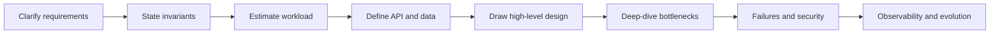
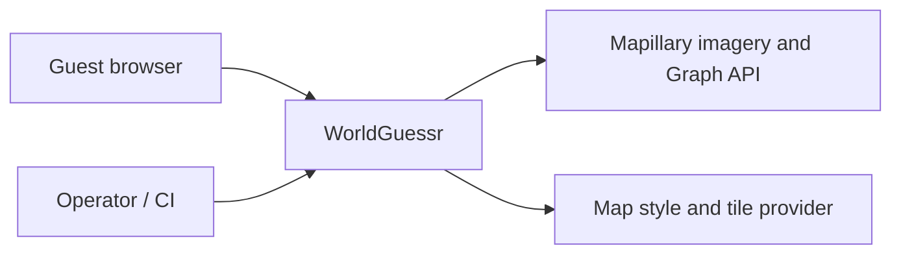
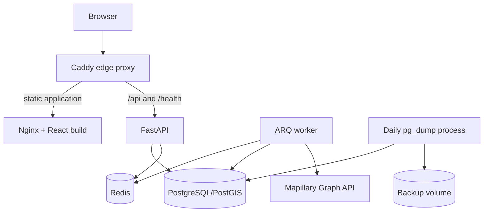
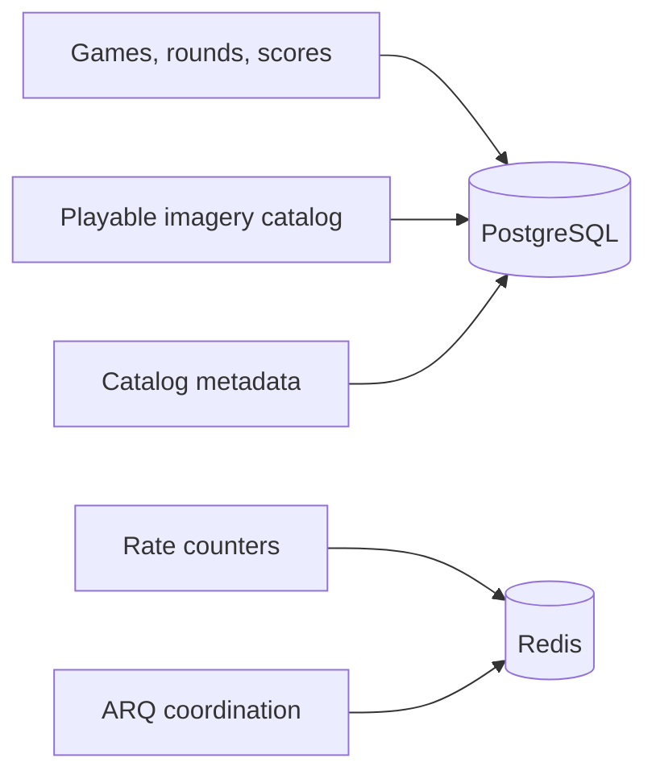
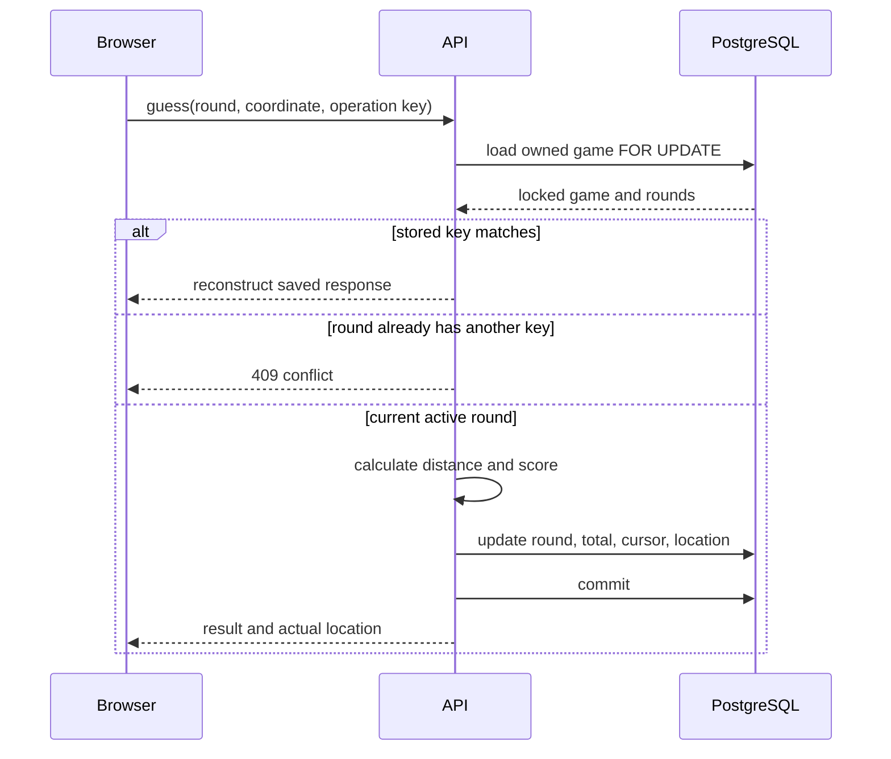
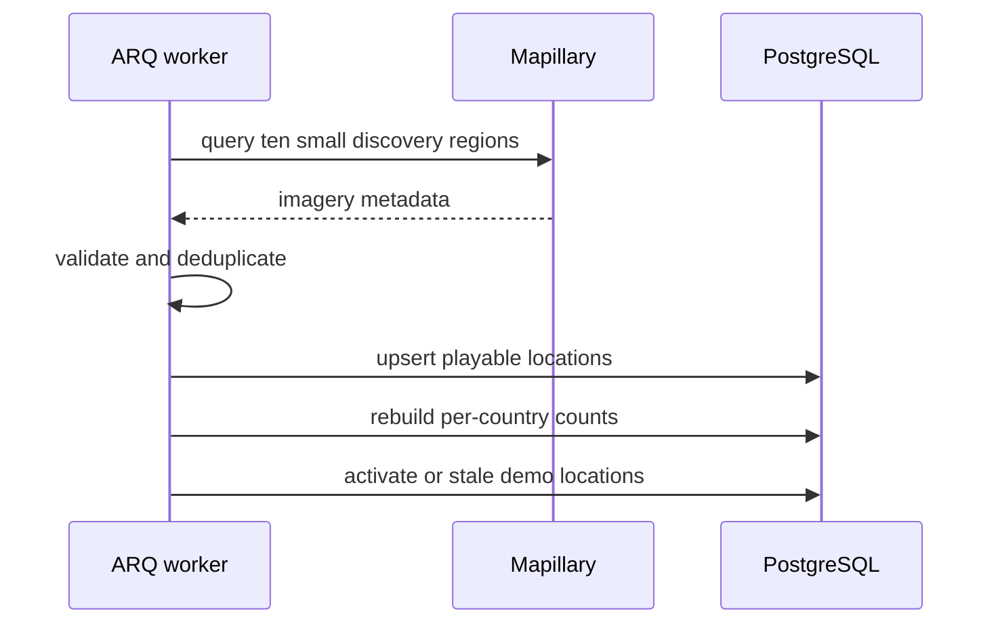
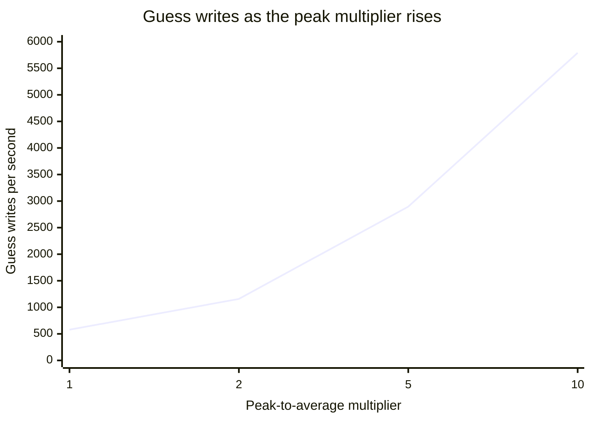
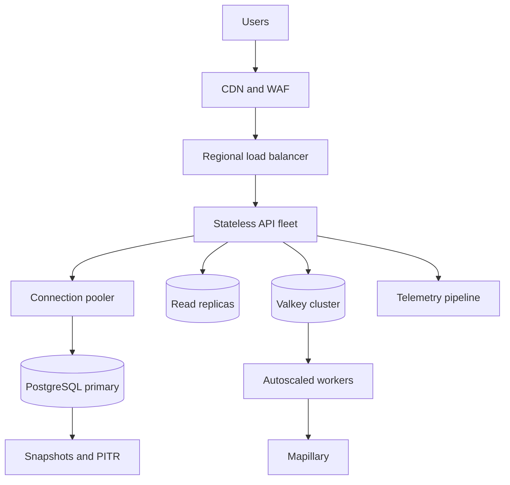

# 03 · Architecture and system design

[← Frontend with React](../02-frontend/README.md) · [Course overview](../README.md) ·
[Next: AWS cloud deployment →](../04-cloud-deploy/README.md)

This chapter studies WorldGuessr at two scales. The first half describes the system that exists
in this repository: a guest-only game run as a modular monolith with a background worker. The
second half evolves the same invariants for a hypothetical global audience. Keeping those views
separate prevents a useful future design from being mistaken for implemented behavior.


*Visual anchor: scaling is an evidence-led expansion around invariants, not an automatic rewrite
into microservices.*

## A repeatable system-design interview structure



Use the structure as a conversation, not a monologue. Confirm scope and the dominant quality
attribute first; 99.99% availability, global writes, strict consistency, and a tiny budget
produce different designs. Make assumptions visible, calculate orders of magnitude, and spend
most of the interview on the risky write path rather than naming every possible service.

| Stage | Questions to make explicit |
|---|---|
| Requirements | users, core operations, exclusions, latency, availability, durability, compliance |
| Invariants | what must never happen; what may be stale, duplicated, delayed, or rebuilt |
| Estimates | average and peak RPS, read/write ratio, object size, growth, retention, bandwidth |
| API/data | resource identity, access pattern, schema, indexes, partition key, idempotency |
| High level | edge, compute, authoritative store, cache, queues/workers, external dependencies |
| Deep dives | hottest path, concurrency, cache invalidation, queue semantics, overload, hot keys |
| Operations | failure matrix, SLI/SLO, backup, RPO/RTO, security boundaries, evolution triggers |

## Part I: the implemented system

### Requirements and invariants

The product has a deliberately narrow scope:

- A guest receives five mystery locations.
- Each round accepts exactly one authoritative guess.
- A game can be resumed from the same browser session.
- The server calculates distance and score.
- The real answer is hidden until a guess is committed.
- Mapillary catalog work happens outside the request path.

The most important invariants are:

1. A game contains five ordered rounds.
2. Only the guest session that created a game may read or mutate it.
3. Only the current round may be guessed.
4. A round contributes to the total at most once.
5. Retrying the same submitted operation returns the same result.
6. PostgreSQL contains all authoritative game and score state.

Architecture becomes easier to evaluate when these rules are stated before technologies are
chosen. PostgreSQL and row locks are justified by invariants 3–6; Redis is not.

### System context



The browser loads the application, calls the game API, displays Mapillary imagery, and loads
the configured map style and its tiles. The server-side worker separately calls Mapillary's
Graph API to discover imagery metadata. Browser and server tokens therefore have different
trust boundaries.

### Runtime containers



`compose.yaml` defines seven services:

| Service | Architectural role |
|---|---|
| Caddy | Only published entry point; TLS, compression, headers, and routing |
| Frontend | Nginx serving immutable Vite output and SPA fallback |
| Backend | Uvicorn/FastAPI request process |
| Migrate | One-shot Alembic upgrade before API and worker startup |
| Worker | ARQ process for catalog and cleanup jobs |
| PostgreSQL | Authoritative relational state and PostGIS extension |
| Redis | Rate-limit counters and ARQ coordination |
| Backup | Scheduled logical PostgreSQL dumps |

The frontend, backend, and worker are separate processes but not separate business services.
The backend and worker use the same image, package, database schema, and release. The
architecture is a modular monolith with multiple process types.

### Network and trust boundaries

Compose defines an `edge` network and an `internal` network. Only Caddy publishes host ports.
The browser cannot directly reach PostgreSQL or Redis. The internal network is marked
`internal: true`; the worker additionally joins the edge network because it needs outbound
provider access.

Caddy routes `/api/*` and `/health/*` to FastAPI and everything else to the frontend server.
This same-origin shape is important:

- the browser can send the guest cookie without enabling cross-origin credentials;
- FastAPI can compare mutation origins to one configured public origin;
- API paths do not expose internal service names;
- one edge layer owns compression and browser security headers.

The Content Security Policy permits the mapping providers and WebGL workers needed by the
application. It includes allowances such as unsafe script evaluation and inline styles that
should be reviewed with actual Mapillary/MapLibre requirements rather than treated as ideal
defaults.

### Durable and reconstructible data



PostgreSQL stores:

- games, ownership identifiers, status, current round, and totals;
- every round, selected location, guess, distance, score, and idempotency key;
- playable locations and catalog counts;
- schema placeholders for provider cursor and circuit state.

Redis stores no unique game result. Losing it removes rate-limit buckets and worker queue state
but not scores or catalog records. The worker can run its scheduled discovery again.

The provider schema suggests stronger resumability than the current worker implements:
`provider_cursor` and `ProviderState` are present but not used. The implemented discovery is a
bounded periodic refresh of fixed city boxes.

### Game creation flow

```mermaid
sequenceDiagram
  participant B as Browser
  participant C as Caddy
  participant A as FastAPI
  participant P as PostgreSQL

  B->>C: POST /api/v1/games
  C->>A: proxy request
  A->>A: verify origin and guest cookie
  A->>P: load eligible countries
  A->>P: load recent guest locations
  A->>A: choose five weighted locations
  A->>P: insert game and rounds; commit
  P-->>A: durable game
  A-->>B: 201 + current imagery metadata
```

Location selection is synchronous and database-backed. It favors country diversity, avoids
recent locations where possible, and weights candidates by quality. If the catalog is below
the required threshold, the API returns `503` rather than creating an invalid game.

Five locations are chosen up front. This makes a game stable across refreshes and provider
outages: after creation, progressing through the rounds does not require another Mapillary
Graph API call.

### Guess transaction and consistency



The write path uses strong consistency because a double score would violate the product.
`SELECT FOR UPDATE` makes concurrent guesses for one game wait on the same database row.
Persisted idempotency data turns an uncertain network retry into a read of the already
committed result.

The transaction is the consistency boundary. Redis, the provider, and the browser do not
participate. This keeps a guess available even when Mapillary discovery or Redis job processing
is unavailable, subject to the rate limiter's fail-open behavior.

### Resume and expiry

The browser stores a game UUID in `localStorage`, while the server stores ownership in a signed
cookie and database column. On reload, the frontend sends the UUID; the API verifies the cookie
before returning the current round.

Games receive an expiry time at creation. Accessing an expired game changes its status and
returns `410`. The worker later deletes expired rows. This two-stage behavior distinguishes the
domain fact “expired” from physical retention cleanup.

The frontend never removes the saved UUID after showing the final summary. On the next load it
detects the completed game and reloads the summary. Starting another game overwrites the
pointer.

### Catalog ingestion flow



Catalog work is decoupled from player requests because provider latency and failure are not
appropriate for the game creation path. The worker uses bounded retry and jitter, and it
splits a dense-region query into smaller cells for a known provider response.

The queue is not a full event pipeline. Jobs are periodic and can be reconstructed; there is
no dead-letter flow, cursor-resume logic, or persisted circuit breaker in the current code.

### Availability and failure behavior

| Failure | Current behavior |
|---|---|
| PostgreSQL unavailable | Game reads and writes fail; readiness returns `503` |
| Redis unavailable | Readiness returns `503`; API limits fail open; ARQ work stops |
| Mapillary Graph API unavailable | Existing games and catalog continue; refill logs failures |
| Browser imagery token missing | Game UI shows an imagery placeholder |
| Tile/style provider unavailable | Guess map cannot render normally |
| Lost guess response | Same-key retry returns the saved result |
| Two different concurrent guesses | One commits; the other receives `409` |
| Expired game | API marks it expired and returns `410`; worker later deletes it |

Readiness currently requires Redis even though gameplay requests can fail open without it.
That is a deployment policy choice: Kubernetes will remove an API pod from service during a
Redis outage despite the application being capable of partial service.

### Security model

The repository applies several complementary controls:

- unpredictable game UUIDs and opaque guest identifiers;
- signed, HttpOnly, SameSite cookies;
- per-game ownership checks;
- same-origin checks for mutations;
- Pydantic coordinate validation;
- server-authoritative scoring and answers;
- request rate limiting;
- edge security headers and an application request ID;
- no direct host exposure for data stores;
- environment-based secrets rather than frontend embedding of server tokens.

This is not a complete internet abuse strategy. IP rate limits need trusted proxy handling,
origin validation is not authentication, and public provider tokens require provider-side
restrictions. Cloud deployment also needs a WAF or equivalent edge limit, TLS, secret rotation,
and monitored audit paths.

### Observability and operations

FastAPI exposes liveness, dependency-aware readiness, and a minimal Prometheus text endpoint.
Middleware emits JSON request events with request ID, path, status, and duration.

Useful signals for this design include:

- request rate, error rate, and latency by normalized route;
- database connection-pool wait and transaction time;
- row-lock wait on hot games;
- Redis latency and rate-limit decisions;
- worker run duration, failure count, and last success;
- active catalog count and freshness by country;
- provider response codes and retry volume;
- backup age and restore-test outcome.

The current metrics are process-local counters. They demonstrate instrumentation but do not
provide durable, replica-wide monitoring by themselves.

### Architectural decisions

**Modular monolith.** One domain and schema avoid distributed transactions and duplicated
contracts. API and worker processes still scale separately.

**PostgreSQL authority.** Constraints, transactions, and row locks protect the highest-value
invariants.

**Redis for disposable coordination.** Rate limits and jobs benefit from low latency, while a
flush must not erase game truth.

**Precomputed rounds.** Choosing all five locations at game creation isolates active games from
provider discovery.

**Same-origin web architecture.** A single edge address simplifies cookies, routing, and
browser security.

**Provider adapter in a worker.** External latency and backoff do not consume API request
capacity.

## Part II: evolving to large scale

The following design is a capacity exercise, not a description of the checked-in deployment.

### Workload assumptions

Assume:

- 10 million daily active guests;
- one five-round game per guest per day;
- 50 million guess writes per day;
- a 10× peak-to-average multiplier;
- roughly three additional API operations per game for creation, resume, and summary.

Fifty million guesses per day average about `579` writes per second and peak around `5,800`.
Including other requests and retries, an initial peak budget of roughly `8,000` API requests
per second is reasonable.



This graph is not a benchmark. It visualizes the explicit traffic assumption so an interviewer
can challenge the multiplier or daily-active-user model and immediately see the capacity impact.

If a game and its rounds consume roughly 2 KB before indexes and backups, new logical data is
about 20 GB per day. Real database storage should budget multiple times that amount for indexes,
row overhead, write-ahead logs, replicas, and retention.

The purpose of estimates is not false precision. They reveal the likely pressure points:
database writes and retention matter more than the tiny JSON responses.

### Scaled request architecture



The React assets are immutable and belong at a CDN. API instances remain stateless because
guest ownership is carried by the cookie and game state is in PostgreSQL. A load balancer can
therefore distribute requests without sticky sessions.

Autoscaling only helps if downstream capacity grows safely. Thousands of API instances opening
independent database pools can exhaust PostgreSQL. Pool sizes, a connection proxy, admission
control, and load testing are part of the scaling design.

### Database evolution

Guess writes still require one authoritative primary per game. Useful steps, in order, are:

1. Tune queries, indexes, pool limits, and retention.
2. Separate slow analytics from the transactional database.
3. Add read replicas for summaries, catalog views, and other non-authoritative reads.
4. Partition games and rounds by creation time when retention and index maintenance justify it.
5. Archive or aggregate expired history according to product requirements.
6. Shard only after a measurable single-primary limit.

If sharding becomes necessary, the game UUID or a derived shard key can keep all rounds for one
game on the same shard. Cross-game leaderboards would need a separate aggregation path; the
current guest-only scope avoids that complexity.

Serializable isolation across all requests would be broader and more expensive than the
per-game row lock. The narrow lock continues to match the invariant even at larger scale,
provided hot-game attacks are controlled and lock wait is monitored.

### Cache and rate-limit design

Redis/Valkey can hold:

- distributed rate-limit counters;
- short-lived public configuration;
- eligible-country summaries with versioned keys;
- reconstructible job queues;
- carefully chosen hot, non-authoritative reads.

Games and scores should not silently move into cache as their only copy. Cache-aside entries
need TTLs and invalidation or versioning. A cache miss reads PostgreSQL; a cache loss increases
database load, so recovery needs admission control to prevent a thundering herd.

At global scale, rate limiting starts at the edge. Application limits can then protect
guest/game-specific rules while the WAF absorbs obvious floods before they consume regional
connections.

### Provider protection and worker backpressure

Catalog discovery has a different scale from guesses and should remain asynchronous. A mature
pipeline would add:

- bounded queues and explicit concurrency per provider;
- exponential retry with jitter and retry classification;
- persisted cursors for resumable pages;
- a circuit breaker that stops calls during sustained failure;
- queue-age-based autoscaling;
- dead-letter inspection for permanently invalid records;
- catalog freshness SLOs and per-country coverage alarms.

When Mapillary is unavailable for hours, workers should stop increasing pressure while games
continue from the existing catalog. Admission control may pause new game creation only when
catalog quality drops below a defined safety threshold.

### Multi-AZ and regional recovery

Within one region, the first availability step is:

- load balancers and API pods across availability zones;
- Multi-AZ PostgreSQL with automated failover;
- replicated Valkey for coordination;
- redundant NAT or controlled egress paths for workers;
- tested backups and point-in-time recovery.

Active/passive multi-region is simpler than active/active because one game has a single writer.
In active/passive, DNS or global routing shifts new traffic after the data plane is restored or
promoted. Active/active would require a home region per game or a distributed database with
clear conflict semantics.

Possible production objectives are 99.9% gameplay availability, p95 reads below 300 ms, p95
guess writes below 500 ms, an RPO of at most five minutes, and an RTO of at most one hour.
These are design targets; the current repository contains no load or recovery evidence proving
them.

### Analytics without blocking gameplay

Request middleware should not synchronously send gameplay analytics to a remote warehouse.
Instead, a committed guess can produce a small event through a bounded outbox or asynchronous
pipeline. Consumers build aggregates independently.

An outbox written in the same PostgreSQL transaction can guarantee that a committed guess
event is eventually visible without making the analytics system part of the guess transaction.
If analytics can tolerate gaps, a simpler log-derived pipeline may be enough.

### Evolution triggers

The modular monolith should change when evidence identifies a boundary:

| Signal | Likely response |
|---|---|
| API CPU or latency dominates | Add replicas and profile handlers |
| Database pool saturation | Limit pools, add a proxy, optimize queries |
| Summary reads pressure primary | Add a read replica |
| Retention/index maintenance grows | Partition or archive old games |
| Provider queue age grows | Scale workers and enforce provider concurrency |
| Independent teams own stable domains | Consider service boundaries |
| Regional outage requirement appears | Add active/passive regional recovery |

Traffic alone does not require microservices. A separately scalable worker already isolates the
most different workload without splitting ownership of game transactions.

## System-design interview drill

For each answer, name the invariant, expected load, chosen mechanism, failure behavior, and the
signal that would tell you to revise the design.

| Prompt | Strong answer framework |
|---|---|
| Why start with a modular monolith? | One domain and transactional store make correctness, deployment, and local development simpler. Modules and separate process types preserve boundaries. Split only when independent scaling, availability, data ownership, or team autonomy pays the network and operational cost. |
| Strong versus eventual consistency here? | A round and total must change atomically, so the guess path is strongly consistent. Catalog freshness, analytics, caches, and telemetry may lag because stale or repeated processing does not corrupt a score. State the user-visible consequence of staleness. |
| What does CAP actually change? | CAP concerns behavior during a network partition in a distributed data system: choose whether an operation remains available or preserves a single consistent view. It does not mean a normal system simply picks two forever, and latency/consistency trade-offs exist even without a partition. |
| When should a response be cached? | Start with access pattern, cost, acceptable staleness, and invalidation ownership. Prefer reconstructible reads such as configuration or catalog summaries. Define key, TTL/version, miss path, write policy, eviction behavior, and protection against a cold-cache stampede. |
| Why not cache game truth as the only copy? | Eviction, failover, expiry, and asynchronous replication can lose or reorder state. PostgreSQL constraints and transactions protect the invariant. A cache can accelerate reads if a miss returns to the authority and invalidation semantics are explicit. |
| How would you choose a partition key? | Co-locate data used in one transaction, spread traffic and storage, and support dominant queries. Game ID keeps a game's rounds together, but inspect key distribution and future cross-game queries. A bad key creates hot partitions or scatter-gather reads. |
| Queue delivery: exactly once? | Transport usually offers at-least-once or at-most-once trade-offs; end-to-end “exactly once” requires application semantics. Use stable message identity, idempotent consumers, atomic state transition/outbox where needed, bounded retries, visibility timeouts, and dead-letter inspection. |
| How do you prevent a worker backlog from taking down the system? | Bound producer and consumer rates, expose oldest-message age, cap concurrency per dependency, shed or pause low-value work, apply retry backoff/jitter, and scale on queue age. Unbounded retries amplify the outage they are reacting to. |
| Horizontal scaling caused database failure—why? | Stateless instances still open pools and create downstream concurrency. Aggregate connections, lock contention, and query volume can exceed the database. Cap per-pod pools, use a connection proxy where appropriate, add admission control, optimize queries, and scale from end-to-end tests. |
| Read replica consistency problem? | Replication is often asynchronous, so a read immediately after a primary write may be stale. Route read-after-write paths to the primary, carry a consistency token/LSN where supported, tolerate a bounded delay, or redesign the UX. Do not hide the choice. |
| Multi-AZ versus multi-region? | Multi-AZ handles localized infrastructure failure with low-latency synchronous or managed failover. Multi-region addresses regional disaster and latency but adds replication lag, routing, split-brain prevention, data residency, and much higher operational cost. Start from RTO/RPO. |
| SLI, SLO, and SLA? | An SLI is a measured user-relevant behavior; an SLO is its target over a window; an SLA adds explicit consequences. For guessing, define successful authoritative submissions and latency percentiles, exclusions, window, and error budget—not just pod uptime. |
| RPO versus RTO? | RPO is tolerable data loss measured back from failure; RTO is tolerable restoration time. They drive backup frequency, replication, automation, and cost. A backup policy is incomplete until restore drills prove the achieved values. |
| When use a transactional outbox? | When a database change and published event must not diverge. Write domain state and an outbox row in one local transaction; a relay publishes with retries; consumers deduplicate. It trades dual-write loss for eventual delivery, extra storage, ordering rules, and cleanup. |
| How would you investigate a hot game or hot key? | Compare key-level rate and lock wait, confirm whether traffic is legitimate or abusive, protect with per-key admission limits, keep critical sections short, and avoid global locks. Sharding does not split one hot key; the product or consistency boundary may need to change. |

### Failure-injection prompts

Practice narrating expected behavior before proposing a fix:

1. Redis is down for 20 minutes while PostgreSQL is healthy.
2. A client times out after the database commits a guess.
3. Mapillary returns `429` for six hours and the worker queue grows.
4. A read replica is 30 seconds behind after game completion.
5. One availability zone disappears during a rolling deployment.
6. A restored database is consistent but the application secret still points to the old endpoint.

For every scenario, cover detection, blast radius, automatic behavior, user experience, operator
action, data reconciliation, and the permanent prevention or test you would add.

## External reading: architecture foundations

**Correctness and distributed communication**

- [HTTP Semantics, RFC 9110](https://www.rfc-editor.org/rfc/rfc9110.html) — safe and idempotent
  methods, status codes, caching, and conditional requests.
- [PostgreSQL transaction isolation](https://www.postgresql.org/docs/current/transaction-iso.html)
  and [explicit locking](https://www.postgresql.org/docs/current/explicit-locking.html) — the
  actual guarantees beneath the design.
- [Idempotent Receiver pattern](https://martinfowler.com/articles/patterns-of-distributed-systems/idempotent-receiver.html)
  — replaying a stored outcome after an ambiguous response.
- [Transactional Outbox pattern](https://microservices.io/patterns/data/transactional-outbox.html)
  — avoiding a database/message-broker dual write; evaluate ordering and duplicate delivery.

**Resilience and scale**

- [AWS: timeouts, retries, and backoff with jitter](https://aws.amazon.com/builders-library/timeouts-retries-and-backoff-with-jitter/)
  — retry amplification, timeout selection, backoff, and jitter.
- [AWS: avoiding insurmountable queue backlogs](https://aws.amazon.com/builders-library/avoiding-insurmountable-queue-backlogs/)
  — queue age, retry storms, and recovery capacity.
- [Cache-Aside pattern](https://learn.microsoft.com/en-us/azure/architecture/patterns/cache-aside)
  — population, invalidation, staleness, and eviction trade-offs.
- [Circuit Breaker pattern](https://learn.microsoft.com/en-us/azure/architecture/patterns/circuit-breaker)
  — closed, open, and half-open behavior around sustained dependency failure.
- [Google SRE: handling overload](https://sre.google/sre-book/handling-overload/) — admission,
  load shedding, capacity, and graceful degradation.
- [Google SRE: addressing cascading failures](https://sre.google/sre-book/addressing-cascading-failures/)
  — why retries, queues, and resource exhaustion can compound an incident.

**Reliability and communication**

- [Google SRE: service-level objectives](https://sre.google/sre-book/service-level-objectives/)
  — user-centered SLIs, percentile latency, targets, and error budgets.
- [OpenTelemetry concepts](https://opentelemetry.io/docs/concepts/) — traces, metrics, logs,
  context propagation, and semantic conventions.
- [AWS Well-Architected Reliability Pillar](https://docs.aws.amazon.com/wellarchitected/latest/reliability-pillar/welcome.html)
  — failure management, change management, and recovery planning.
- [C4 model](https://c4model.com/) — communicating context, containers, components, and code at
  the right zoom level.

## Architecture mental model

- Start from invariants and failure behavior, then choose components.
- Describe the checked-in system separately from a future production design.
- Strong consistency belongs on score-changing transactions; catalog freshness can be eventual.
- Stateless API replicas do not remove database and connection-pool limits.
- Redis loss should degrade performance or coordination, never erase authoritative results.
- Provider backpressure protects both the dependency and the application.
- Availability claims need load tests, failover drills, restore evidence, and monitoring.
- Scale the modular monolith until data, workload, or team boundaries provide a concrete reason
  to split it.

[Continue to AWS cloud deployment →](../04-cloud-deploy/README.md)
