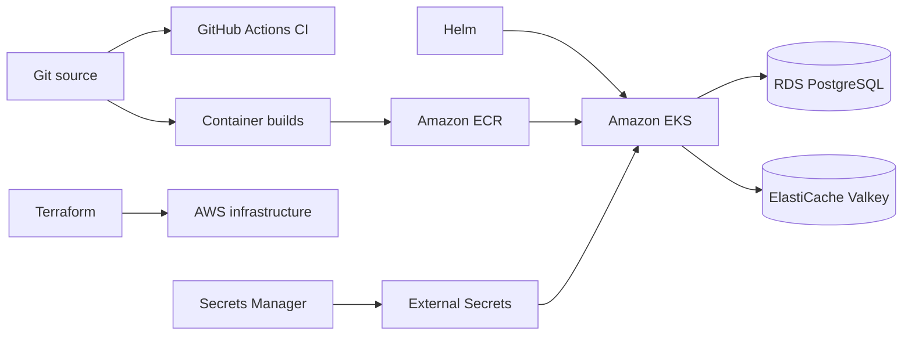
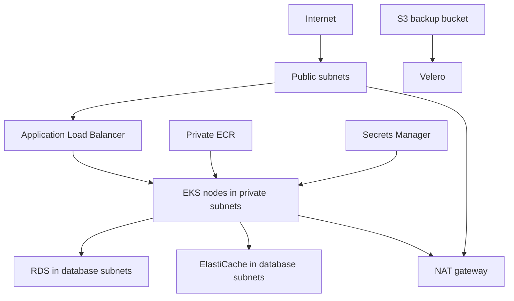
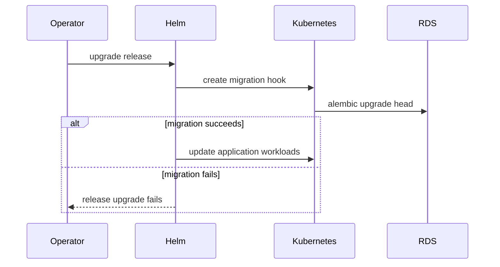
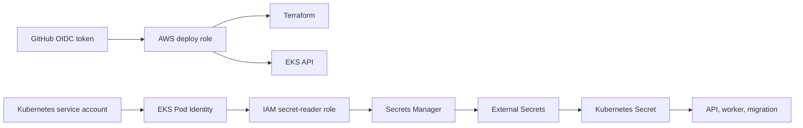

# 04 · AWS cloud deployment

[← Architecture and system design](../03-system-design/README.md) ·
[Course overview](../README.md)

This chapter explains the AWS deployment path represented by `infra/terraform`,
`infra/helm/worldguessr`, the container files, and the GitHub Actions workflows. It is an
architecture reading guide, not a promise that the repository is a one-command production
platform. The final sections make the required external components and current gaps explicit.


*Visual anchor: build, provision, deploy, operate, and recover are separate control loops. A
green deployment does not by itself prove data durability, security, or user availability.*

### What an interviewer is testing

| Area | A strong explanation connects |
|---|---|
| Containers | build reproducibility, minimal runtime, non-root execution, immutable identity, and scanning |
| Infrastructure as code | desired state, dependency graph, remote state/locking, plan review, drift, and ownership |
| Kubernetes | Pod, Deployment, Service, Ingress/controller, Job, probe, resources, autoscaling, and disruption |
| AWS | VPC traffic paths, EKS responsibility, managed data HA, workload identity, encryption, and backups |
| Delivery | short-lived CI identity, artifact provenance, migration compatibility, rollout evidence, and rollback |
| Operations | SLOs, telemetry, incident response, restore drills, capacity, cost, and safe teardown |

## From source code to a cloud workload



The deployment has three different declarative layers:

| Layer | Owns |
|---|---|
| Containerfiles | Runtime filesystem, dependencies, startup command, and exposed port |
| Terraform | AWS network, cluster, registries, managed data, secret container, and backup bucket |
| Helm | Kubernetes deployments, services, ingress, migration job, probes, scaling, and policies |

Keeping these layers separate matters. Terraform should not rebuild application images, and a
Helm upgrade should not recreate the VPC.

## Container images

### Backend image

The backend image starts from Python 3.14 slim, installs the exact production dependency set
from `uv.lock`, copies Alembic and application code, drops to a non-root user, and starts Uvicorn:

```text
uvicorn app.main:app --host 0.0.0.0 --port 8000 --proxy-headers
```

The same image can run three roles by overriding the command:

- API: the default Uvicorn command;
- worker: `arq app.worker.WorkerSettings`;
- migration: `alembic upgrade head`.

One artifact for these roles prevents dependency drift between migrations, workers, and the
API. It also means a release must remain compatible with the schema state during rollout.

### Frontend image

The frontend uses a multi-stage build. Node compiles TypeScript and produces Vite assets; the
runtime stage contains only Nginx and the `dist` directory. Nginx listens on port 8080, serves
SPA routes through `index.html`, and provides a lightweight `/health` response.

The build runs `npm ci`, so dependency installation must match the checked-in lockfile.

### Immutable image identity

The Helm chart addresses images as `repository@sha256:digest`. A digest identifies exact
content, unlike a mutable tag such as `latest`. Rollback therefore means selecting a previously
known digest and compatible configuration, not hoping a tag still points to old bytes.

Frontend and backend are separate ECR repositories and normally produce different digests.
The current manual deployment workflow accepts only one digest and assigns it to both
repositories. That interface is a repository gap: a real release needs distinct frontend and
backend digest inputs or a release manifest containing both.

## Terraform: the AWS foundation

Terraform pins its CLI and AWS provider ranges and applies default project, environment, and
management tags. Those tags support inventory and cost attribution.



The diagram shows the intended completed platform. Terraform directly creates the subnets,
EKS, RDS, ElastiCache, ECR, Secrets Manager entry, and S3 bucket. The ALB, controller, Velero,
and workload identity connections need additional installation or configuration.

### VPC and subnets

The VPC module creates two availability-zone slices with:

- public subnets for internet-facing load-balancer and NAT resources;
- private subnets for EKS nodes;
- database subnets for RDS and ElastiCache;
- DNS hostnames and Kubernetes load-balancer discovery tags.

Private subnets do not automatically mean “no internet access.” Nodes and workers use NAT for
outbound package, registry, AWS API, provider, map, or telemetry traffic.

Lab defaults use one NAT gateway, creating a cross-AZ dependency and possible data-transfer
cost. `production_safeguards=true` requests one NAT per AZ, reducing that single point of
failure at higher monthly cost.

### EKS

The EKS module creates Kubernetes 1.36, enables the Pod Identity agent, and creates one managed
x86 node group in private subnets. The default node range is one to three `t3.medium`
instances.

The cluster API endpoint is public, and the cluster creator receives administrator permissions.
Those choices simplify initial access but need tighter endpoint allowlists and role design for
a production organization.

Enabling the Pod Identity agent only installs part of workload identity. IAM roles, policies,
and pod identity associations for specific service accounts are not defined in this Terraform.

### ECR

Terraform creates immutable, scan-on-push repositories for frontend and backend. ECR encryption
uses AWS-managed AES-256 at rest. A complete release pipeline must build each image, authenticate
to ECR, push it, evaluate scan results, and pass its digest into Helm. The checked-in deployment
workflow currently starts after those build-and-push steps.

### RDS PostgreSQL

RDS PostgreSQL 18 stores authoritative game data. The resource enables storage encryption,
starts with 20 GB, permits autoscaling to 100 GB, and lets RDS manage the master password in a
separate AWS-managed secret.

The environment toggle changes important durability settings:

| Setting | Default | With production safeguards |
|---|---|---|
| Multi-AZ | Off | On |
| Backup retention | 1 day | 14 days |
| Deletion protection | Off | On |
| Final snapshot on deletion | Skipped | Required |
| Performance Insights | Off | On |

The application database URL and credentials still need to be assembled and exposed to the
workload. Creating an RDS-managed master secret does not automatically populate the separate
application secret expected by Helm.

The initial Alembic migration runs `CREATE EXTENSION IF NOT EXISTS postgis`. The database role
and RDS engine must permit that extension, and migration success is a rollout prerequisite.

### ElastiCache Valkey

ElastiCache provides Redis-compatible Valkey for ARQ and rate limiting. It uses database
subnets, encryption at rest, and encryption in transit. Production safeguards change the
single-node group into a two-node, Multi-AZ group with automatic failover.

Transit encryption means the application connection settings must use the appropriate TLS
scheme and certificate behavior. Merely inserting the Terraform endpoint into the current
default `redis://` shape would not describe the encrypted managed connection correctly.

The data security group allows ports 5432 and 6379 from the private subnet CIDR ranges. This is
broader than security-group-to-security-group rules and includes any workload placed in those
subnets.

### Secrets Manager

Terraform creates an empty application secret container with a description instructing the
operator to populate database URL, signing secret, and Mapillary tokens out of band. Terraform
does not write secret values into state, which avoids one common leak.

Helm expects an External Secrets operator to copy fields from this AWS secret into a Kubernetes
Secret named `worldguessr-runtime`. That flow also requires:

- External Secrets Operator installed in the cluster;
- a `ClusterSecretStore` with the configured name;
- IAM permission to read the secret;
- Pod Identity or another supported AWS authentication mechanism;
- secret field names matching the application's environment variables.

None of those prerequisites is created by the current Terraform or chart.

### S3 backup bucket

The S3 bucket is versioned, encrypted, and blocks public access. It is intended for Velero
Kubernetes backups. In disposable mode Terraform may force-delete it; production safeguards
prevent that shortcut.

Velero protects Kubernetes objects and, when configured, volume data. It does not replace RDS
snapshots, point-in-time recovery, or a tested logical database restore. ElastiCache remains
reconstructible.

## Helm: Kubernetes application topology

The chart deploys frontend, backend, worker, migration, services, ingress, an ExternalSecret,
autoscaling, and availability policies.

### Migration before rollout

The migration `Job` is a Helm `pre-install,pre-upgrade` hook. Its name includes the Helm release
revision, and it retries a failed pod up to two times.



This ordering prevents new code from starting before its schema is installed. Safe production
migrations should remain backward compatible with the old application during rolling updates:
expand the schema, deploy compatible code, migrate data, and remove old fields in a later
release.

The ExternalSecret is a normal chart object while the migration is a pre-install hook.
On a first installation, the hook can run before the generated Kubernetes Secret exists. The
current ordering therefore needs correction or out-of-band secret creation before it can be
relied upon.

### Backend

The backend Deployment:

- runs two replicas by default;
- reads all environment variables from `worldguessr-runtime`;
- uses distinct liveness and readiness endpoints;
- declares resource requests and limits;
- spreads pods across zones when possible;
- uses the `worldguessr` service account.

A `Service` gives it a stable in-cluster address. A PodDisruptionBudget requires at least one
backend pod during voluntary disruption. An HPA scales between two and ten replicas at 70%
average CPU.

CPU is a useful starting signal but does not measure request latency, database pool wait, or
traffic directly. Scaling the API also multiplies potential database connections.

### Frontend

The frontend Deployment mirrors the replica and resource configuration and probes Nginx's
`/health`. Its Service exposes port 80 inside the cluster and forwards to container port 8080.

Because frontend assets are immutable, a larger deployment would normally place them behind a
CDN. The current chart serves them through pods and the ALB.

### Worker

The worker is a single replica of the backend image with the ARQ command. It receives the same
runtime secret and resource settings as the API.

The chart does not define worker liveness, readiness, autoscaling, or a disruption budget.
Queue age and provider concurrency would be better scaling signals than CPU. Running multiple
workers is possible because ARQ coordinates through Valkey, but provider limits must be
considered.

### Ingress and ALB

The Ingress uses class `alb`, an internet-facing scheme, and IP targets. `/api` routes to the
backend and `/` routes to the frontend.

An Ingress resource does not itself run an ALB. The AWS Load Balancer Controller must already
be installed with IAM permissions. The checked-in Terraform and Helm chart do not install it.

Although `domain_name` and `ingress.certificateArn` values exist, the chart does not use them
to define a host, HTTPS listener, certificate annotation, or redirect. The implemented ingress
is therefore HTTP-only unless supplemented externally.

The chart also routes only `/api` to the backend, not `/health` or `/metrics`. Those operational
endpoints are available inside the cluster but not through this ingress.

### NetworkPolicy

The chart creates a namespace-wide default-deny ingress policy. No corresponding allow
policies are defined for:

- ALB to frontend and backend;
- frontend or probes to their target pods;
- monitoring to metrics;
- DNS and external egress, if egress becomes restricted.

Under a network plugin that enforces Kubernetes NetworkPolicy, the current deny policy can
make the application unreachable. A policy set is only complete when explicit required flows
are allowed and verified.

## CI and deployment workflows

### Continuous integration

The CI workflow runs on pull requests and pushes to `main`. It:

- starts PostgreSQL/PostGIS and Valkey service containers;
- installs locked backend dependencies with `uv`;
- runs Ruff and backend tests with a coverage threshold;
- installs frontend dependencies and runs lint, tests, and build;
- regenerates the OpenAPI/TypeScript contract and checks for drift;
- formats and validates Terraform;
- lints and renders the Helm chart.

This is a useful separation between application checks and infrastructure checks. It validates
syntax and templates but does not provision AWS or prove runtime connectivity.

The repository's docs build is not currently included in this CI workflow, so broken handbook
navigation or Mermaid syntax would not block a pull request.

### Manual AWS workflow

The manual workflow obtains AWS credentials through GitHub OIDC and offers `plan`, `apply`,
`deploy`, and `destroy` actions. Short-lived role assumption is safer than storing long-lived
AWS access keys.

The workflow assumes that the OIDC provider, deploy role, trust policy, environment protection,
AWS region variable, EKS name, Terraform backend, images, and required cluster add-ons already
exist. Terraform in this repository does not create the GitHub OIDC role described by
`github_oidc_subject`.

`apply -auto-approve` and `destroy -auto-approve` are high-impact production-environment
operations. Environment reviewers and saved-plan review should be part of the control plane.

## A complete deployment lifecycle

Conceptually, a release moves through these stages:

1. **Validate source.** Run application, contract, documentation, Terraform, and Helm checks.
2. **Provision stateful foundations.** Create the VPC, registries, cluster, database, cache,
   secret container, and backup bucket with reviewed Terraform plans.
3. **Install cluster prerequisites.** Configure load-balancer control, External Secrets,
   workload identity, metrics, DNS/TLS integration, storage/backup tooling, and network policy
   enforcement.
4. **Populate configuration.** Store application-shaped secret values without committing them
   or exposing them in workflow logs.
5. **Build and scan images.** Build frontend and backend separately, push to their ECR
   repositories, and record each immutable digest.
6. **Migrate and release.** Run a backward-compatible migration, roll out workloads, and wait
   for readiness.
7. **Verify behavior.** Check the public route, five-round flow, resume, health, logs, catalog
   freshness, and metrics.
8. **Observe and recover.** Monitor the rollout and roll back application digests when safe;
   use database recovery when schema or durable data requires it.

These are dependency stages, not shell instructions. Each stage should have automated evidence
before promotion to a protected production environment.

## Secrets and identity model



Deployment identity and runtime identity should be separate. The deploy role needs narrowly
scoped infrastructure and cluster permissions. The runtime secret reader should only read the
specific application secret. Application pods do not need Terraform or ECR administration.

The database master secret is also different from the application runtime secret. In a mature
system, the application would use a dedicated database role with only required schema and data
permissions rather than the RDS master user.

## Availability, scaling, and rollout behavior

Two API replicas, a disruption budget, topology spread, readiness probes, and an HPA provide a
starting Kubernetes availability model. They cannot compensate for the default single node,
single-AZ database, single Valkey node, single NAT, or missing cluster add-ons.

Production safeguards improve managed data and NAT redundancy, but the node group's default
minimum remains one. Availability must be evaluated across the whole request path.

Rolling deployments need:

- more than one ready replica;
- backward-compatible configuration and database changes;
- readiness that does not pass before the app can serve;
- an appropriate termination grace period and connection draining;
- enough spare cluster capacity to run old and new pods together;
- a rollback digest and schema strategy.

The current chart has no explicit rolling-update settings or termination lifecycle hook, so it
relies on Kubernetes defaults.

## Backups and recovery boundaries

| Asset | Protection mechanism | Recovery concern |
|---|---|---|
| Kubernetes objects | Intended Velero backups to S3 | Velero and its IAM/config are external |
| PostgreSQL data | RDS automated backup/PITR; optional logical dumps | Restore must be tested and endpoint/secret updated |
| Valkey data | Recreate or managed failover | No authoritative game data should depend on it |
| Container images | Immutable ECR repositories | Retention policy must keep rollback digests |
| Secrets | Secrets Manager recovery window in protected mode | Rotation and restored workload access must be tested |
| Terraform state | External backend is implied, not configured | State loss blocks safe infrastructure management |

Backup creation is not the same as recovery. A useful drill restores RDS to a new instance,
updates a controlled secret, runs compatible migrations, verifies game totals, and records the
actual recovery time. Namespace restoration should be tested separately from database recovery.

## Cost model

The persistent cost drivers are likely EKS control plane, worker nodes, NAT gateways and
processing, RDS, ElastiCache, ALB, logs, backups, and cross-AZ traffic. ECR and the small S3
bucket are usually secondary until retention grows.

The “lab” defaults reduce managed-data and NAT redundancy but still create chargeable
always-on services. Kubernetes is being used to demonstrate orchestration; for a small,
single-application team, ECS, App Runner, or a simpler VM/container platform can reduce fixed
cost and operational surface.

Cost controls include:

- environment tags and budgets;
- short log and image retention appropriate to the environment;
- VPC endpoints when their fixed cost is justified by NAT traffic;
- right-sized nodes and managed data instances;
- scheduled deletion of disposable environments;
- inventory after teardown, especially load balancers, EIPs, ENIs, snapshots, and secret
  recovery windows.

## Teardown as an architecture concern

Deletion order matters because Kubernetes controllers create AWS resources outside the direct
Terraform graph. Ingress-created load balancers and target groups should be removed before the
cluster and VPC. Versioned S3 objects, retained RDS snapshots, ECR images, ENIs, EIPs, DNS,
certificates, and Secrets Manager recovery objects can survive the obvious destroy operation.

Protected production data should never be destroyed merely to make Terraform finish. Final
snapshots and exported evidence need an explicit owner and retention decision.

## Implemented, assumed, and incomplete

| Capability | Repository status |
|---|---|
| VPC, subnet classes, NAT, and tags | Implemented in Terraform |
| EKS and managed node group | Implemented in Terraform |
| ECR repositories | Implemented; image build/push workflow absent |
| RDS PostgreSQL and managed master secret | Implemented |
| ElastiCache Valkey | Implemented; application TLS URL wiring must be supplied |
| Application secret container | Implemented empty; values and mapping supplied externally |
| S3 Velero bucket | Implemented; Velero installation/configuration absent |
| AWS Load Balancer Controller | Required but not installed |
| External Secrets Operator and ClusterSecretStore | Required but not installed |
| Pod Identity IAM roles and associations | Agent enabled; roles/associations absent |
| GitHub OIDC deploy role | Workflow assumes it; Terraform does not create it |
| DNS, ACM certificate, and HTTPS ingress | Variables exist; resources/chart wiring absent |
| NetworkPolicy allows | Default deny exists; required allows absent |
| Central metrics, logs, dashboards, and alarms | Application emits basics; AWS resources absent |
| Terraform remote state and locking | Not configured in repository |
| Separate frontend/backend release digests | ECR supports them; workflow incorrectly uses one |
| Documentation CI | Local script exists; CI job absent |

This table is the practical boundary between an educational infrastructure blueprint and a
repeatable production deployment.

## Cloud and DevOps interview drill

Answer from the outside in: user request, edge, cluster, workload, managed dependency, identity,
and recovery. Distinguish what the platform manages from what the application team still owns.

| Prompt | Strong answer framework |
|---|---|
| Image, container, and Pod? | An image is immutable packaged content; a container is a runtime process plus isolation/configuration; a Pod is Kubernetes' scheduling unit for one or more tightly coupled containers sharing network and volumes. A Deployment reconciles replica Pods over revisions. |
| Why a multi-stage frontend build? | Build tooling and source are needed to compile, not serve. The runtime image should contain only static output and the server, reducing size and attack surface. Pin dependencies, use a lockfile, run as non-root where possible, scan, and identify the final image by digest. |
| What does Terraform state do? | It binds configuration addresses to real resources and stores metadata needed to plan changes. Teams need protected remote storage, locking, encryption, versioning, scoped access, and recovery. State can contain secrets; never treat it as harmless generated JSON. |
| Terraform versus Helm? | Terraform provisions cloud foundations and their lifecycle; Helm templates/releases Kubernetes objects inside a cluster. Either can technically cross the boundary, but clear ownership reduces competing reconcilers and confusing destroy order. Both require reviewed plans/rendered output and drift controls. |
| What makes a subnet public or private? | Routing, not its name. A public subnet has a route to an internet gateway and a resource still needs a public address/security rules. A private workload can initiate egress through NAT or private service endpoints without accepting unsolicited internet ingress. Trace both forward and return paths. |
| Security group versus NACL versus NetworkPolicy? | Security groups are stateful AWS resource/ENI firewalls; subnet NACLs are stateless ordered allow/deny rules; Kubernetes NetworkPolicy selects Pods and controls L3/L4 flows when the CNI enforces it. Use layers deliberately and debug which control owns the dropped path. |
| Deployment, Service, and Ingress? | A Deployment maintains interchangeable Pods; a Service supplies stable discovery and load distribution to selected Pods; an Ingress declares HTTP routing but needs an installed controller that creates or programs the actual data plane. |
| Liveness, readiness, and startup probes? | Startup protects slow initialization from premature liveness failure. Liveness determines restart. Readiness controls endpoint membership. Probe the narrow condition each decision needs; a shared dependency in liveness can restart every pod during one downstream incident. |
| Requests, limits, and HPA interaction? | The scheduler places Pods using requests; limits constrain runtime; CPU HPA utilization is measured relative to requests. Bad requests distort placement and scaling. Scale on a signal tied to demand, then verify downstream capacity and stabilization behavior. |
| What does a PodDisruptionBudget guarantee? | It limits simultaneous *voluntary* disruption for selected healthy Pods. It does not create replicas, prevent node/AZ failure, or guarantee traffic readiness. Combine replicas, topology spread/anti-affinity, node capacity, probes, and rollout settings. |
| Why can default-deny NetworkPolicy break a release? | Once selected, ingress or egress becomes denied unless explicitly allowed, and enforcement depends on the network plugin. Inventory DNS, probes, ingress controller, service-to-service, metrics, and external dependency flows; add least-privilege allows and test them in-cluster. |
| Kubernetes Secret versus a secret manager? | A Kubernetes Secret is an API object and distribution mechanism, not automatically a full secret-management system. Use envelope encryption/RBAC, avoid logs and manifests, fetch or sync from a managed store through scoped workload identity, and design rotation and restart behavior. |
| Why workload identity instead of access keys? | Pods exchange their service-account identity for short-lived, scoped credentials. This removes static keys from images and CI variables, supports least privilege and audit, and limits blast radius. Trust policy and service-account binding are part of the security boundary. |
| How do you perform a zero-downtime schema change? | Use expand-and-contract: add backward-compatible schema, deploy code that works with old and new, backfill separately, switch reads/writes, then remove old fields later. Gate rollout on migration, but plan first-install secret/order dependencies and rollback compatibility. |
| Tag versus digest? | A tag is a mutable name; a digest identifies exact image content. Deploy digests and retain release metadata for frontend/backend/config/schema. Reproducibility also needs pinned inputs and provenance—a digest identifies bytes but does not prove they are safe. |
| Multi-AZ RDS versus backup? | Multi-AZ improves availability through a standby/failover; it can replicate operator mistakes or bad writes. Backups/PITR address recovery to an earlier state. Define RPO/RTO, retention, deletion protection, and regularly restore into an isolated target. |
| Why can an HPA make an outage worse? | More Pods can multiply database connections, retries, provider calls, and cold starts. A demand signal may rise because a dependency is slow. Bound concurrency, coordinate cluster and downstream capacity, use backpressure, and test the whole path under failure. |
| What should a secure deployment pipeline prove? | Reviewed source and IaC, locked dependencies, tests, generated-contract consistency, isolated build, vulnerability/policy checks, signed/provenanced immutable artifacts, short-lived OIDC identity, protected environment approval, migration success, rollout health, and auditable rollback. |
| How do you choose EKS versus ECS/App Runner/VMs? | Start from workload and team needs: orchestration features, portability, ecosystem, scale, isolation, operational skill, and fixed cost. Kubernetes is justified when its control-plane abstractions and ecosystem repay cluster/add-on/upgrade complexity—not simply because containers are used. |

### Production-readiness review

Before calling a design production-ready, walk every row with evidence rather than intent:

| Gate | Evidence |
|---|---|
| Release | separate immutable digests, provenance, scan result, rendered manifests, migration compatibility |
| Availability | multi-zone replicas and nodes, managed-data redundancy, disruption test, load-test percentiles |
| Security | threat model, least-privilege roles, network-flow tests, secret rotation, audit trail |
| Operations | actionable dashboards/alerts, runbooks, ownership, synthetic user journey, capacity headroom |
| Recovery | restore logs, measured RPO/RTO, secret/endpoint cutover, integrity verification, rollback drill |
| Cost | tagged inventory, budget alerts, unit cost, retention policy, non-production shutdown, teardown audit |

## External reading: cloud foundations

**Containers and infrastructure as code**

- [Podman builds](https://docs.podman.io/en/latest/markdown/podman-build.1.html) — separating
  build dependencies from minimal runtime artifacts.
- [Terraform language overview](https://developer.hashicorp.com/terraform/language) — resources,
  expressions, modules, and dependency inference.
- [Terraform state](https://developer.hashicorp.com/terraform/language/state) and
  [state storage/locking](https://developer.hashicorp.com/terraform/language/state/backends) —
  bindings, collaboration, sensitive data, and concurrent-operation control.
- [Helm chart hooks](https://helm.sh/docs/topics/charts_hooks/) — lifecycle order, weights,
  deletion policy, and why hook resources need deliberate ownership.

**Kubernetes mechanics**

- [Kubernetes Deployments](https://kubernetes.io/docs/concepts/workloads/controllers/deployment/)
  — reconciliation, rollout strategy, progress, and rollback.
- [Liveness, readiness, and startup probes](https://kubernetes.io/docs/concepts/workloads/pods/probes/)
  — the three distinct orchestration decisions.
- [Horizontal Pod Autoscaling](https://kubernetes.io/docs/tasks/run-application/horizontal-pod-autoscale/)
  — metric ratios, missing data, stabilization, and scaling behavior.
- [Disruptions and PodDisruptionBudgets](https://kubernetes.io/docs/concepts/workloads/pods/disruptions/)
  — voluntary versus involuntary failure boundaries.
- [Network Policies](https://kubernetes.io/docs/concepts/services-networking/network-policies/)
  — selection, isolation, additive policy, and enforcement prerequisites.
- [Good practices for Kubernetes Secrets](https://kubernetes.io/docs/concepts/security/secrets-good-practices/)
  — encryption, RBAC, container access, and external secret stores.

**AWS reliability, identity, and delivery**

- [Amazon EKS Best Practices Guide](https://docs.aws.amazon.com/eks/latest/best-practices/introduction.html)
  — security, reliability, networking, scale, upgrades, and cost.
- [Running highly available EKS applications](https://docs.aws.amazon.com/eks/latest/best-practices/application.html)
  — multiple zones, disruption budgets, capacity, and graceful termination.
- [EKS Pod Identity](https://docs.aws.amazon.com/eks/latest/userguide/pod-identities.html) —
  service-account-to-IAM role mapping and temporary credentials.
- [RDS Multi-AZ deployments](https://docs.aws.amazon.com/AmazonRDS/latest/UserGuide/Concepts.MultiAZ.html)
  — standby/failover models and what they do not replace.
- [GitHub Actions OIDC for AWS](https://docs.github.com/en/actions/how-tos/secure-your-work/security-harden-deployments/oidc-in-aws)
  — short-lived deployment credentials and trust conditions.
- [AWS Well-Architected Framework](https://docs.aws.amazon.com/wellarchitected/latest/framework/welcome.html)
  — operational excellence, security, reliability, performance, cost, and sustainability.
- [SLSA supply-chain specification](https://slsa.dev/spec/v1.2/) — progressive tracks and
  guarantees for source controls, build provenance, and artifact integrity.

## Cloud deployment mental model

- Containers package processes; Terraform creates AWS foundations; Helm releases Kubernetes
  workloads.
- A managed service still needs identity, networking, configuration, monitoring, and recovery.
- Kubernetes manifests depend on controllers that must be installed and authorized.
- Immutable digests make releases identifiable, but frontend and backend artifacts remain
  distinct.
- Migration order and backward compatibility determine whether rolling deployment is safe.
- Availability is limited by the least redundant required dependency.
- Secrets should flow through scoped workload identity, not source control or long-lived keys.
- Backup systems must be paired with rehearsed restore procedures.
- A Terraform destroy is not proof that controller-created or retained AWS resources are gone.

[Return to the course overview →](../README.md)
