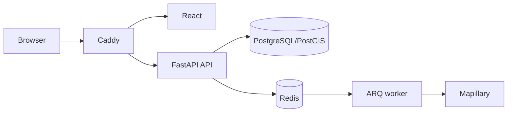

# WorldGuessr full-stack and cloud handbook

This is a reading-first guide to the five-round guest game and a structured full-stack interview
refresher. It explains the FastAPI and React concepts used by the application, follows its real
data and request flows, and then studies both its current architecture and an AWS deployment
path. Every chapter combines implementation evidence, diagrams, an original memory aid,
interview questions with answer frameworks, and authoritative external reading.

The goal is not to memorize framework trivia. By the end, you should be able to trace a request
from browser to database, defend the consistency and security choices, evolve the design under
load, and explain how the system is built, released, observed, and recovered in the cloud.

## Learning path

1. [Backend with FastAPI](01-backend/README.md) — requests, dependencies, Pydantic,
   SQLAlchemy/PostgreSQL, idempotency, Redis, workers, security, and observability.
2. [Frontend with React](02-frontend/README.md) — TypeScript, React 19, reducers, hooks, API
   contracts, lazy loading, Mapillary, MapLibre, accessibility, and testing strategy.
3. [Architecture and system design](03-system-design/README.md) — the implemented modular
   monolith followed by an equally detailed evolution to large-scale operation.
4. [AWS cloud deployment](04-cloud-deploy/README.md) — containers, Terraform, EKS, managed
   data, Helm, identity, CI/CD, recovery, cost, and the current infrastructure gaps.

## Interview-readiness map

| Interview area | What you should be able to do after reading | Best chapter |
|---|---|---|
| Backend/API | Design a validated HTTP API; explain dependency injection, sessions, transactions, locks, idempotency, rate limits, jobs, and probes | [Backend](01-backend/README.md) |
| Frontend | Model UI state, reason about renders and effects, protect async flows, type an API boundary, integrate imperative libraries, and test accessibly | [Frontend](02-frontend/README.md) |
| System design | Turn requirements into invariants and estimates; choose data, cache, queue, consistency, partitioning, and recovery strategies | [Architecture](03-system-design/README.md) |
| Cloud/DevOps | Explain containers, infrastructure as code, Kubernetes primitives, managed AWS data, workload identity, rollout safety, observability, and cost | [AWS](04-cloud-deploy/README.md) |
| Cross-stack debugging | Follow one request and its correlation ID across browser, edge, API, database, worker, logs, metrics, and deployment | All four, in order |

## A focused study plan

Use a three-pass method rather than reading once and hoping it sticks:

1. **Understand (days 1–4).** Read one chapter per day. Redraw its main diagram from memory and
   say each “mental model” bullet aloud in your own words.
2. **Retrieve (days 5–8).** Return only to the interview drill in each chapter. Answer before
   revealing the answer framework, then repair gaps with the linked primary sources.
3. **Simulate (days 9–10).** Give a 45-minute system-design answer for WorldGuessr, then do a
   45-minute cross-stack debugging narrative: slow guess submission, duplicate retry, Redis
   outage, and a failed cloud rollout.

An answer is interview-ready when it includes the requirement, chosen mechanism, failure mode,
trade-off, and evidence you would monitor or test. Naming a technology alone is not an answer.

## How to read the handbook

Start with the backend if you want to follow the system from its source of truth, or jump
directly to the frontend if React is your immediate refresher. The architecture chapter joins
both halves into end-to-end flows. The AWS chapter then maps the same processes and data stores
onto the checked-in cloud infrastructure.

Code snippets are explanatory extracts rather than tasks to run. Mermaid diagrams show exact
component, state, transaction, and deployment relationships; the chapter illustrations are
conceptual memory aids. Where the repository contains a placeholder or incomplete production
mechanism, the chapter labels it explicitly. External reading prioritizes specifications,
official documentation, and primary engineering guidance.

## Architectural ground rules

- PostgreSQL is authoritative. Redis/Valkey contains only reconstructible queues and limits.
- Every mutation is origin checked; guess retries carry one stable `Idempotency-Key` UUID.
- Local development remains Podman Compose + Caddy.
- Cloud defaults are disposable and inexpensive, not production-HA.
- Never commit tokens or secret values.

Next: [01 · Backend with FastAPI →](01-backend/README.md)
